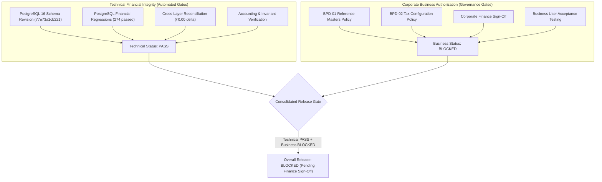

# CollectFlow Business Release Acceptance Checklist (WP-06)
## Financial Release Governance & Sign-Off Matrix

**Status:** `AWAITING_FINANCE_APPROVAL`  
**Date:** 2026-10-20  
**Scope Notice:** Release preparation gate separating technical verification from corporate business acceptance.  

> [!IMPORTANT]
> Technical tests passing does NOT equal business release acceptance.
> Overall Business Release Acceptance is **BLOCKED** pending formal Finance Directorate sign-off.
> No production data, statutory activations, or cloud promotions are authorized.

---

### 1. Dual Release Acceptance Architecture

---

### 2. Detailed Acceptance Checklist

| Item | Gate Category | Requirement | Verification Method | Status | Sign-Off Reference |
| :--- | :--- | :--- | :--- | :--- | :--- |
| **FIN-01** | Technical | PostgreSQL Schema Revision `77e73a1cb221` verified | `alembic_version` query | **PASS** | Automated CI |
| **FIN-02** | Technical | Decimal precision arithmetic & ROUND_HALF_UP | Unit & domain model tests | **PASS** | Automated CI |
| **FIN-03** | Technical | Order to Invoice Conversion & Net-30 Default Due Date | Domain model integration | **PASS** | Automated CI |
| **FIN-04** | Technical | Invoice immutability & historical snapshot preservation | Lifecycle integration tests | **PASS** | Automated CI |
| **FIN-05** | Technical | Unbilled POs excluded from Recognized AR (₹0.00) | Multi-source reconciliation | **PASS** | Automated CI |
| **FIN-06** | Technical | Accounting Invariant: Cash + TDS = Total Settled | Invariant assertion | **PASS** | Automated CI |
| **FIN-07** | Technical | Accounting Invariant: Invoiced - Settled = Outstanding | Invariant assertion | **PASS** | Automated CI |
| **FIN-08** | Technical | Payment correction & signed negative reversal integrity | Reversal relational tests | **PASS** | Automated CI |
| **FIN-09** | Technical | Payment idempotency key deduplication | Concurrency tests | **PASS** | Automated CI |
| **FIN-10** | Technical | 17-Column Excel & CSV export structure and values | Cross-layer reconciliation | **PASS** | Automated CI |
| **FIN-11** | Technical | Single-use export token authorization & session binding | Token manager integration | **PASS** | Automated CI |
| **FIN-12** | Technical | Statutory reference endpoints reject unapproved mutations | Negative security tests | **PASS** | Automated CI |
| **FIN-13** | Governance | BPD-01 Statutory Reference Masters Policy approved | Corporate review package | **BLOCKED** | Awaiting Finance Sign-Off |
| **FIN-14** | Governance | BPD-02 Default Tax & Statutory Calculations approved | Corporate review package | **BLOCKED** | Awaiting Finance Sign-Off |
| **FIN-15** | Governance | Approved production GST/TDS rates verified | Corporate Directorate order | **BLOCKED** | Awaiting Finance Sign-Off |
| **FIN-16** | Governance | End-user Finance UAT sign-off recorded | UAT report & approval hash | **BLOCKED** | Awaiting Finance Sign-Off |
| **FIN-17** | Governance | Commercial release authorization granted | Corporate Executive Board | **BLOCKED** | Awaiting Finance Sign-Off |

---

### 3. Acceptance Verdicts

- **Technical Financial Integrity Verdict:** **PASS** (All 12 technical financial invariants verified with exact ₹0.00 delta across PostgreSQL, REST API, exports, and UI).
- **Business Authorization Verdict:** **BLOCKED** (Pending formal Finance Directorate review and sign-off on BPD-01, BPD-02, and statutory rates).
- **Overall Release-Readiness Verdict:** **BLOCKED** (Fail-closed release gate: software is technically sound, but legally/operationally blocked from production activation).
