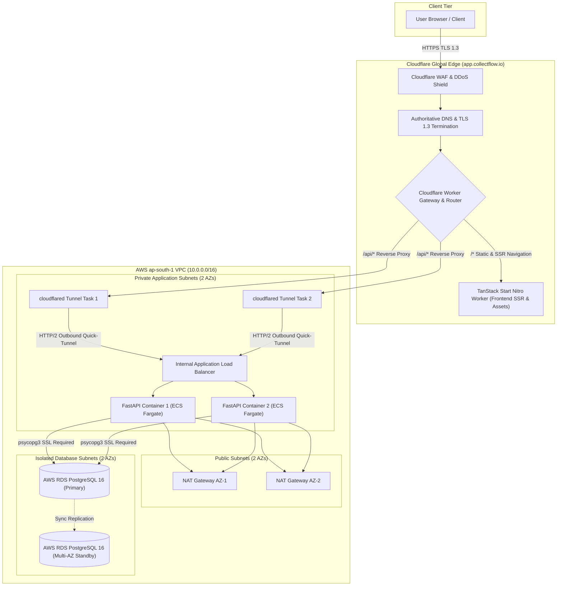

# CollectFlow Post-Phase 4C Release Readiness Plan

**Document Reference:** `COLLECTFLOW_POST_4C_RELEASE_READINESS_PLAN.md`  
**Stage:** Post-Phase 4C Release Readiness Preflight (Planning & Read-Only Verification)  
**Date:** October 18, 2026 (Revised per Independent Architecture Review)  
**Status:** DRAFT — AUTHORIZED FOR PLANNING AND ARCHITECTURE REVIEW  
**Recommendation Status:** `NEEDS SECURITY / ARCHITECTURE DECISIONS`  

---

## 1. Executive Summary & Verified Baselines

Phase 4C (Stages 4C.1 through 4C.6) concluded with an independent verification verdict of **ACCEPTANCE WITH LIMITATIONS**, establishing full PostgreSQL 16 relational parity, a 39-scenario Playwright LIVE UAT suite, and zero monetary delta ($\Delta = ₹0.00$) five-source financial reconciliation across direct database models, REST APIs, DOM-rendered figures, and 17-column Excel/CSV exports.

This preflight document establishes a technical roadmap, risk evaluation, and release governance framework for transitioning the complete PostgreSQL-backed CollectFlow application from a local verified test environment into an enterprise staging and production deployment.

### Authoritative Git Baselines & Planning Branches
- **Backend Repository:** [`collectflow`](file:///home/anishb/projects/personal/collectflow)
  - Accepted Baseline Commit: `1eb94b96321780d42527721585551d35f774fa3b`
  - Dedicated Planning Branch: `docs/phase4-release-readiness-preflight`
  - Verified Remote Planning Checkpoint: `f892a6cdec991c5613456917d0fabd04e1ea499a`
- **Frontend Repository:** [`cash-flow-buddy-101`](file:///home/anishb/projects/personal/cash-flow-buddy-101)
  - Accepted Baseline Commit: `2085c29e51d28cd5a2466883415442dd861734b7`
  - Dedicated Planning Branch: `docs/phase4-release-readiness-preflight`
  - Verified Remote Planning Checkpoint: `c71b89592e78deb07c3fe770501de715c205c14a`

> [!IMPORTANT]
> **Preflight Constraints:** No cloud infrastructure has been provisioned, no code merged to `main`, no database migrations executed in production, and no application behavior modified during this assessment.

---

## 2. Superseded vs. Authoritative Architecture Decisions

A rigorous review of historical design documentation (Stage 4A through Stage 4C.6) identifies several proposals that have been superseded by subsequent stage implementations:

| Domain | Historical Proposal (Stage 4A/4B) | Accepted Authoritative Architecture (Stage 4C.6) | Status & Justification |
|---|---|---|---|
| **Persistence Engine** | SQLite WAL-mode with `BEGIN IMMEDIATE` locks | Dedicated PostgreSQL 16+ with SQLAlchemy 2.0 ORM, psycopg3 driver, and Alembic migrations | **SUPERSEDED** by Stage 4C.1 for multi-tenant scalability and strict typing. |
| **Payment Mutation** | Physical deletion of erroneous payments allowed in development | Strict physical deletion block (`DELETE /api/payments/{id}` returns HTTP 400); all adjustments execute via non-destructive compensating `REVERSAL` events | **AUTHORITATIVE** (Stage 4C.4). Statutory compliance under Indian accounting standards. |
| **Export Security** | Direct bearer token accepted in download query parameter | Single-use cryptographic tickets issued via `POST /api/export/token` with 5-minute TTL, consumed atomically under PostgreSQL `SELECT FOR UPDATE` | **AUTHORITATIVE** (Stage 4C.5). Eliminates token leakage in access logs and prevents download link sharing. |
| **Reporting Aggregation** | Client-side aggregation of `GET /api/invoices?limit=1000` | Authoritative server-side aggregation endpoints (`/api/reporting/summary`, `/api/reporting/ar-aging`, `/api/payments`) with server pagination | **AUTHORITATIVE** (Stage 4C.5). Prevents 100-invoice truncation and browser memory overflow. |
| **Auth Session Storage** | Browser `sessionStorage` proposed in Stage 4A | Ephemeral in-memory React state (`inMemoryToken`) in Stage 4B/4C; `HttpOnly` same-origin cookies proposed for Production | **EVOLVED**. In-memory tokens protect against persistent XSS but require same-origin cookie architecture for production persistence across reloads. |

---

## 3. Production Hosting Architecture & Private Connectivity (ARCH-01)

### 3.1 Frontend Runtime Clarification: Cloudflare Workers
The accepted frontend repository ([`cash-flow-buddy-101`](file:///home/anishb/projects/personal/cash-flow-buddy-101)) is configured with `@lovable.dev/vite-tanstack-config` and Nitro targeting `cloudflare-module` output (`dist/` and `.output/server/index.mjs`). 
- **Preserved Runtime Target:** The application is architected specifically as a **Cloudflare Worker** with server-side rendering wrappers in [`src/server.ts`](file:///home/anishb/projects/personal/cash-flow-buddy-101/src/server.ts) and [`src/start.ts`](file:///home/anishb/projects/personal/cash-flow-buddy-101/src/start.ts).
- **No Unverified Migration to Pages:** The deployment design retains Cloudflare Workers as the authoritative edge hosting target to preserve compatibility with TanStack Start SSR error wrappers and server functions. Moving to Cloudflare Pages is not assumed to be drop-in compatible and is avoided.

### 3.2 Cloudflare to AWS Private Connectivity Architecture
A production financial system requires seamless edge integration with private AWS backend services without exposing internal infrastructure to the public internet:



#### Provider-Supported Ingress Patterns Evaluated:
1. **Pattern 1: Cloudflare Tunnel (`cloudflared` on ECS Fargate) — RECOMMENDED**
   - **Mechanism:** Deploy lightweight `cloudflared` daemon instances inside private AWS subnets as ECS Fargate tasks (or sidecars to the backend container).
   - **Outbound-Only Connectivity:** `cloudflared` establishes persistent, outbound-only encrypted QUIC/HTTP/2 tunnels to the nearest Cloudflare edge PoPs.
   - **Zero Inbound Ports:** The AWS VPC security groups allow **0 inbound internet traffic**. No public IP addresses are assigned to the Internal Application Load Balancer (ALB) or ECS tasks.
   - **Routing:** Cloudflare routes `app.collectflow.io/api/*` securely through the tunnel directly to the Internal ALB.
   - **Failure Modes & Resilience:** Redundant `cloudflared` tasks across two Availability Zones (`ap-south-1a`, `ap-south-1b`). If one task fails, Cloudflare automatically fails over to the second tunnel connection within milliseconds.

2. **Pattern 2: Public ALB with Cloudflare Authenticated Origin Pull (Alternative)**
   - **Mechanism:** Deploy an internet-facing ALB that strictly enforces TLS Client Authentication (mTLS) with Cloudflare's published Origin CA certificate, coupled with an AWS Security Group restricted to Cloudflare's published IP ranges.
   - **Tradeoffs:** Requires maintaining IP allowlists and public ALB endpoints; more complex certificate rotation lifecycle than Cloudflare Tunnel.

### 3.3 Routing, Origin Access & Health Checks
- **Domain:** `https://app.collectflow.io`
- **Routing Rules:**
  - `/*` $\rightarrow$ Cloudflare Worker (Frontend SSR & static bundles).
  - `/api/*` $\rightarrow$ Cloudflare Tunnel $\rightarrow$ Internal ALB $\rightarrow$ FastAPI backend.
- **TLS Configuration:**
  - Edge: TLS 1.3 with strict modern cipher suites (`HSTS: max-age=63072000; includeSubDomains; preload`).
  - Tunnel: Authenticated end-to-end encryption between Cloudflare edge and `cloudflared` connector.
  - Internal: Internal ALB terminates tunnel traffic; backend calls to RDS PostgreSQL enforce `sslmode=require`.
- **Health Checks & Origin Probes:**
  - Cloudflare Edge Monitor: Probes `https://app.collectflow.io/api/health` every 15 seconds. If backend is unavailable, Worker serves custom branded HTTP 503 maintenance response.
  - Internal ALB Probe: Probes `GET /ready` on backend containers every 10 seconds; auto-deregisters unhealthy tasks if database probe fails.

### 3.4 Recalculated Monthly Cost Assumptions (`ap-south-1` Mumbai)
*The following itemized cost model reflects deployment in AWS Asia Pacific (Mumbai) `ap-south-1` with Multi-AZ redundancy and enterprise networking. Planning estimates only, not binding quotes:*

| Component | AWS Resource & Configuration | Monthly Cost (USD) |
|---|---|---|
| **Frontend & Edge Gateway** | Cloudflare Workers Paid Plan + Custom Domain & WAF | $20 – $30 |
| **Backend Compute** | AWS ECS Fargate: 2 tasks (0.5 vCPU, 1 GB RAM, 24/7 across 2 AZs) | $32 – $42 |
| **Cloudflare Tunnel Connectors** | AWS ECS Fargate: 2 tasks (0.25 vCPU, 0.5 GB RAM for `cloudflared`) | $16 – $22 |
| **Application Load Balancing** | AWS Internal ALB (1 ALB + ~1 LCU average) | $22 – $28 |
| **Managed Database** | AWS RDS PostgreSQL 16 Multi-AZ (`db.t4g.medium`, 100 GB gp3) | $135 – $155 |
| **Outbound NAT Gateway** | AWS NAT Gateway (1 per AZ for private subnet outbound: images/updates) | $65 – $75 |
| **Automated Backups & PITR** | AWS RDS Snapshot storage + S3 Standard encrypted bucket | $12 – $20 |
| **Secrets & Telemetry** | AWS Secrets Manager (4 secrets) + CloudWatch Logs (10 GB ingestion) | $15 – $25 |
| **Data Egress & Transfer** | Cloudflare Tunnel egress (inbound to Cloudflare is free; minimal AWS egress) | $5 – $12 |
| **Total Estimated Run-Rate** | **High-Availability Production Environment (`ap-south-1`)** | **$322 – $409 / month** |

---

## 4. Production Authentication & Bootstrap Security (ARCH-03)

### 4.1 Same-Origin Cookie Session Architecture
To eliminate session loss on browser reload without introducing persistent XSS vulnerabilities:

1. **Cookie Directives:**
   - On successful `POST /api/auth/login`, backend issues:
     ```http
     Set-Cookie: collectflow_session=<session_secret>; Path=/api; HttpOnly; Secure; SameSite=Lax; Max-Age=604800
     ```
   - `HttpOnly`: Strictly blocks client-side JavaScript (`document.cookie` cannot inspect or exfiltrate token).
   - `Secure`: Transmitted solely over TLS connections.
   - `SameSite=Lax`: Prevents cross-site POST invocation while permitting safe top-level navigations.
   - `Path=/api`: Limits cookie transmission strictly to backend API endpoints.

2. **Session Lifecycle & Invalidation:**
   - **Generation:** 256 bits CSPRNG entropy (`secrets.token_hex(32)`).
   - **Storage:** SHA-256 hash stored in `sessions.token_hash`. Raw secret exists only on the client cookie.
   - **Expiration:** 7-day hard expiry (`expires_at`); optional 24-hour sliding inactivity expiration.
   - **Logout:** `POST /api/auth/logout` deletes session record in PostgreSQL and issues expired cookie header (`Max-Age=0`).

3. **Origin & Host Header Validation:**
   - FastAPI middleware validates that the `Origin` (or `Referer` on navigation) matches the configured production origin (`https://app.collectflow.io`). Unmatched origins are rejected with **HTTP 403 Forbidden**.

4. **CSRF Defense & Negative Test Matrix:**
   - All state-mutating requests (`POST`, `PUT`, `DELETE`) require a custom header: `X-Requested-With: XMLHttpRequest` or `X-CollectFlow-CSRF: 1`.
   - Modern browsers forbid cross-origin forms, images, or scripts from attaching custom headers without CORS preflight approval.
   - **Negative Test Matrix (Must Pass Before Go-Live):**
     1. *Cross-Origin Form POST without Custom Header:* Returns **HTTP 403 Forbidden**.
     2. *Cross-Origin Fetch with Custom Header from Disallowed Origin:* Fails at preflight `OPTIONS` (CORS origin denied).
     3. *Forged Origin Header:* Returns **HTTP 403 Forbidden**.
     4. *Missing Session Cookie:* Returns **HTTP 401 Unauthorized**.
     5. *Expired or Revoked Session Cookie:* Returns **HTTP 401 Unauthorized**.
     6. *Tampered Cookie Secret Value:* Returns **HTTP 401 Unauthorized**.

5. **RBAC & Audit Trail Preservation:**
   - Full compatibility with existing dependencies: `get_current_user`, `require_admin`, `require_finance_or_admin`.
   - All authentication events (success, failure, lockout, logout) continue to record immutable audit rows in `audit_logs` with client IP and `request_id`.

### 4.2 Database Schema Prerequisite: `must_change_password`
The existing `User` model ([`collectflow/app/models/domain_models.py#L85-L96`](file:///home/anishb/projects/personal/collectflow/app/models/domain_models.py#L85-L96)) **does not possess a `must_change_password` column**.
- **Mandatory Prerequisite:** Forced password rotation cannot be implemented purely in code without database backing.
- **Required Action:** Author an additive Alembic migration adding `must_change_password = Column(Boolean, nullable=False, default=False)` to `users`.
- **Enforcement:** When `must_change_password == True`, `get_current_user` intercepts all API calls (except `/api/auth/change-password` and `/api/auth/logout`) and returns **HTTP 403 Password Change Required**.

### 4.3 Protected Bootstrap Secret Delivery
- The initial primary administrator credentials **must never be printed to stdout, build logs, or CI/CD pipelines**.
- **Delivery Mechanism:** The automated bootstrap initializer (`scripts/init_production_db.py`) writes the generated initial password directly into **AWS Secrets Manager** (`/collectflow/production/bootstrap_admin`) with access restricted to the nominated Lead Administrator IAM role.
- Once the initial administrator logs in and changes their password, the temporary secret in Secrets Manager is marked obsolete and rotated.

---

## 5. Financially Safe Migration & Rollback Strategy (ARCH-02)

### 5.1 Removal of Generic `alembic downgrade -1`
In the initial preflight draft, running `alembic downgrade -1` was referenced as a generic rollback step. 
- **CRITICAL AUDIT CORRECTION:** Review of [`migrations/versions/e9ee322f8b96_create_collectflow_v1_domain_schema.py#L289-L322`](file:///home/anishb/projects/personal/collectflow/migrations/versions/e9ee322f8b96_create_collectflow_v1_domain_schema.py#L289-L322) demonstrates that its `downgrade()` function executes:
  `op.drop_table('payment_transactions')`, `op.drop_table('commercial_invoices')`, `op.drop_table('audit_logs')`!
- Running `alembic downgrade -1` against a populated database is **destructive, catastrophic, and illegal under statutory audit standards**.
- **Policy:** Generic `downgrade` commands are strictly forbidden in production runbooks.

### 5.2 Safe Additive-Only Migration Pattern (Expand & Contract)
All future production schema changes must follow the non-destructive **Expand and Contract** pattern:
1. **Phase 1 (Expand):** Add new columns as nullable, add new tables, or introduce non-destructive indexes. Never drop or rename columns in an active migration.
2. **Phase 2 (Dual Write / Compatibility):** Deploy backend application code that writes to new structures while remaining backward-compatible with the old schema.
3. **Phase 3 (Contract):** Once verified across a full financial reporting cycle, deprecate and archive old structures in a planned, separate maintenance release.

### 5.3 Write Freezing & Maintenance Mode
For any deployment requiring exclusive table locks:
1. Activate Cloudflare Edge Maintenance Worker: immediately serves branded HTTP 503 Maintenance Page, gracefully freezing incoming financial writes.
2. Verify in-flight database transactions complete via `pg_stat_activity`.
3. Apply migration.
4. Verify `/ready` probe.
5. Deactivate Maintenance Worker to restore live traffic.

### 5.4 Database Restores: No Claim of Automatic Lossless Recovery
- A database restore (whether from RDS automated snapshot or point-in-time recovery) terminates the live database timeline and replaces it with historical state.
- **Explicit Reality:** Any transactions recorded between the snapshot timestamp and the point of failure will be lost unless replayed from independent bank or application audit logs.
- **Governance Mandate:** A database snapshot restore is a severe disaster recovery action. It requires **explicit joint written authorization from the Head of Finance and Product Owner** before execution.

---

## 6. CI/CD Pipeline & Realistic Operational Targets (ARCH-04)

### 6.1 Automated GitHub Actions Pipeline Structure
To satisfy the automation-first mandate without manual cloud portal actions:

```mermaid
flowchart LR
    subgraph PR_Gate ["PR Validation Pipeline"]
        PR[Developer PR] --> LintCheck[Ruff & ESLint]
        LintCheck --> TypeCheck[tsc & Pydantic Check]
        TypeCheck --> PytestRun[Backend Pytest: 115 tests]
        TypeCheck --> VitestRun[Frontend Vitest: 596 tests]
    end

    subgraph Staging_Gate ["Staging & UAT Pipeline"]
        PytestRun --> MergeStaging[Merge to release/*]
        VitestRun --> MergeStaging
        MergeStaging --> EphemeralPG[Spin Up Ephemeral PG 16]
        EphemeralPG --> MigrateTest[alembic upgrade head]
        MigrateTest --> LiveUAT[Playwright LIVE UAT: 39 tests]
        LiveUAT --> FiveSource[5-Source Reconciliation Verifier]
    end

    subgraph Deploy_Gate ["Deployment Pipeline"]
        FiveSource --> BuildImages[Build Signed Docker Images]
        BuildImages --> DeployStaging[Deploy to Staging via Terraform]
        DeployStaging --> FinSignOff{Finance & PO Sign-Off}
        FinSignOff -->|Approved| CanaryProd[Production ECS Rollout]
    end
```



### 6.2 Realistic Operational Recovery Timeframes
*Absolute guarantees (such as "guaranteed 90-second rollbacks") are removed in favor of realistic orchestrator convergence targets:*
- **ECS Fargate Application Reversion:** Target convergence: **3 to 7 minutes** (governed by ALB connection draining timeouts, minimum healthy task percentages, and container startup latency).
- **Cloudflare Edge Worker Reversion:** Target convergence: **< 1 minute** (instantaneous edge bundle activation).
- **RDS Point-In-Time Disaster Recovery:** Target convergence: **20 to 45 minutes** (governed by EBS volume initialization and WAL log replay duration).

---

## 7. Business Policy & Release Boundaries (ARCH-04)

### 7.1 Customer Deactivation Policy Revision
- **Independent Review Correction:** The previous recommendation to automatically cancel unbilled purchase orders upon customer deactivation has been removed.
- **Revised Policy:**
  1. Soft-deactivating a customer (`is_active=False`) blocks creating *new* purchase orders or invoices for that customer.
  2. **Existing unbilled purchase orders remain active and intact.** Cancelling a purchase order is a separate, audited commercial action requiring formal cancellation reasons.
  3. **Outstanding receivables remain legally binding.** Existing commercial invoices remain active.
  4. The Reports Hub, Customer Exposure views, and AR Aging summaries **continue to display inactive customers who possess unbilled commitments or outstanding balances** (flagged with an "Inactive Customer" badge) so financial commitments are never hidden.

### 7.2 Statutory Accounting & Closed-Period Status
- Formal statutory accounting policies (BPD-01) remain strictly **PENDING QUALIFIED FINANCE / AUDITOR APPROVAL**.
- No code change or assumption of closed-period behavior will be implemented prior to written sign-off.

### 7.3 Domestic INR Scope Enforcement Gate
- If approved under BPD-04, an explicit server-side technical gate will be added:
  `if item.currency != "INR" or item.exchange_rate != Decimal("1.000000"): raise HTTPException(400, "Only domestic INR transactions are supported in v1.0")`.

---

## 8. Implementation Work Packages (Reconciled WP-01 to WP-06)

The implementation work packages are formally reconciled:

- **WP-01: Dependency & Environment Isolation Hardening (Backend)**
  - Update `requirements.txt` with pinned versions of SQLAlchemy 2.0, psycopg3, Alembic, and Argon2-cffi.
  - Refactor `app/core/database.py` to support `COLLECTFLOW_ENV=production` with mandatory SSL and remote RDS DSN validation.
- **WP-02: User Model Migration & Production Initializer**
  - Create Alembic migration adding `must_change_password` column to `users`.
  - Author `scripts/init_production_db.py` to seed clean statutory reference data and bootstrap one primary administrator.
  - Deliver bootstrap credentials securely to AWS Secrets Manager (zero plaintext output).
  - Add hard safety abort to `scripts/seed_postgres_fixtures.py` preventing execution outside `COLLECTFLOW_ENV=test`.
- **WP-03: Same-Origin Cookie Authentication & CSRF Hardening**
  - Implement `HttpOnly; Secure; SameSite=Lax` cookie issuance and renewal in FastAPI.
  - Add Origin / Referer validation and custom CSRF header check (`X-Requested-With: XMLHttpRequest`).
  - Update frontend `ApiClient` to leverage cookie sessions while preserving in-memory user profile state.
  - Implement negative test battery validating CSRF and origin rejection.
- **WP-04: GitHub Actions CI/CD Pipeline Automation**
  - Implement `.github/workflows/ci.yml` (lint, typecheck, pytest, vitest).
  - Implement `.github/workflows/release.yml` (ephemeral PostgreSQL 16 container, Playwright LIVE UAT, 5-source reconciliation verifier, signed container build).
- **WP-05: Infrastructure as Code (Terraform) & Cloudflare Tunnel**
  - Author Terraform modules for AWS VPC (`ap-south-1`), private subnets, RDS PostgreSQL Multi-AZ, Internal ALB, and ECS Fargate.
  - Configure `cloudflared` tunnel connectors on ECS Fargate for private ingress.
- **WP-06: Business Policy Technical Gates & Domestic INR Scoping**
  - Implement INR-only validation gate on purchase orders and invoices (`currency == "INR"`, `exchange_rate == 1.000000`).
  - Update Customer Directory and Reports Hub to display inactive customer exposure badges.
