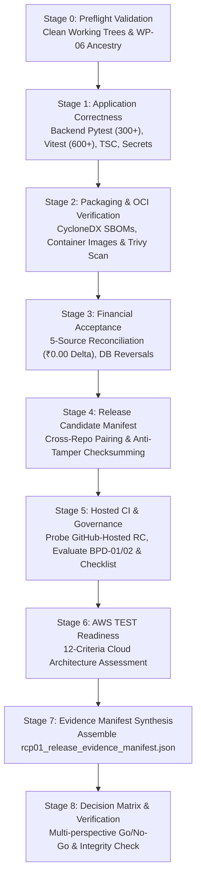

# CollectFlow Release Candidate Preflight Plan (RCP-01)

## 1. Executive Summary & Objective

This document defines the formal release candidate preflight execution plan for the CollectFlow Order-to-Cash application. The objective of RCP-01 is to establish a verifiable, auditable, and immutable Release Candidate evidence package across both repositories (`AnishB-Personal/collectflow` and `AnishB-Personal/cash-flow-buddy-101`) without performing cloud deployment, mutating production financial records, or merging unreleased features into the `main` branch.

Preflight confirms:
- Exact cross-repository Git source identity and commit ancestry.
- Zero untracked or uncommitted working tree modifications.
- Complete application correctness (PostgreSQL backend regression, frontend Vitest component tests, TypeScript type safety).
- Dependency and container security posture (zero vulnerability exceptions, secrets scan clean, OCI metadata verified).
- Five-source financial reconciliation integrity (₹0.00 delta across all 10 core metrics).
- Evaluation of GitHub-hosted Release Candidate automation.
- Statutory configuration and Corporate Finance governance compliance.
- Deployment readiness assessment for the first isolated AWS TEST environment across 12 criteria.
- Master Evidence Manifest assembly and anti-forgery verification.

---

## 2. Accepted Baselines & Historical Work Package Summary

Work packages WP-01 through WP-06 have been independently verified, formally accepted, and closed. Their verdicts and boundaries are preserved:

| Work Package | Focus Area | Backend Checkpoint | Frontend Checkpoint | Final Verdict & Limitations |
| :--- | :--- | :--- | :--- | :--- |
| **WP-01** | Backend Hardening & Database Reliability | `1d2bfc9...` | N/A | **PASS** — Verified PostgreSQL dialect, TLS verification contract, safe credential handling. |
| **WP-02** | Portable Container Runtimes | `ed79de7...` | `8907890...` | **PASS** — Unprivileged non-root users, loopback-restricted proxy binds (`127.0.0.1:8080`), relative frontend API paths. |
| **WP-03** | Safe Database Initializer | `b21f26a...` | N/A | **PASS** — Empty schema bootstrap (`77e73a1cb221`), deferred statutory reference activation, idempotency. |
| **WP-04** | Secure Auth & Session Handling | `b93b6e2...` | `93e47e0...` | **PASS** — Argon2id password hashing, atomic login session persistence, HMAC CSRF verification, secure cookies. |
| **WP-05** | Portable CI/CD Automation | `8e92be2...` | `8289c9c...` | **PASS** — Multi-repo release pairing, zero-active vulnerability exception gate, CycloneDX SBOM generation, OCI builds. |
| **WP-06** | Financial Integrity & Governance Gates | `12582f7...` | `c6fc51a...` | **PASS WITH LIMITATIONS** — Technical PASS (5-source ₹0.00 delta); Corporate Finance BLOCKED pending officer signoff. |

---

## 3. Preflight Execution Scope & Target Branches

- **Branch Name (Both Repositories):** `feature/release-rcp01-evidence-preflight`
- **Starting Baselines:**
  - Backend: `12582f7abb3c391e2d80d61ada179629d7825eac`
  - Frontend: `c6fc51a75135b0343d9c7ad90a80ba5fb5b61260`
- **Freeze Sequencing Principle:**
  All preflight automation, unit tests, and release candidate documentation are committed and pushed *prior* to freezing the immutable release candidate SHA. The preflight pipeline runs against this frozen commit state, writing all execution evidence to gitignored directories so that candidate SHAs are never mutated after evidence generation.

---

## 4. Pipeline Execution Stages

The preflight orchestrator ([`scripts/release/run_rcp01_preflight.py`](file:///home/anishb/projects/personal/collectflow/scripts/release/run_rcp01_preflight.py)) executes in 8 sequential stages:

### Detailed Stage Description

1. **Stage 0: Source Integrity & Pre-Check**
   - Asserts zero uncommitted or untracked changes across both repositories (`git status --porcelain`).
   - Verifies ancestry from WP-06 accepted commits via `git merge-base --is-ancestor`.
   - Records frozen 40-character commit SHAs.

2. **Stage 1: Application Correctness & Secrets Audit**
   - Backend: Runs complete pytest regression against real PostgreSQL database; writes JUnit XML and generates `backend_test_evidence.json`.
   - Frontend: Executes 44 Vitest test suites (620 unit/component tests) and runs `tsc --noEmit` type checking.
   - Security: Scans backend and frontend trees using `scan_secrets.py` (zero high/medium findings allowed).
   - Audits: Runs dependency vulnerability audits with zero active exceptions.

3. **Stage 2: Software Supply Chain & OCI Packaging**
   - Generates CycloneDX JSON SBOMs for backend and frontend.
   - Builds backend and frontend OCI images tagged with exact commit SHAs.
   - Scans images with Trivy; enforces `publication_status: DISABLED_BY_DEFAULT`.

4. **Stage 3: Financial Integrity & 5-Source Reconciliation**
   - Runs formal financial acceptance pipeline ([`run_financial_acceptance_pipeline.py`](file:///home/anishb/projects/personal/collectflow/scripts/release/run_financial_acceptance_pipeline.py)).
   - Verifies 10 core financial metrics across 5 architectural layers (DB schema, ORM queries, API payloads, Frontend state, DOM UI).
   - Validates payment reversals, idempotent invoice settlement, and zero statutory reference leaks.

5. **Stage 4: Cross-Repository Release Candidate Gate**
   - Executes `verify_cross_repo_release.py` to confirm bilateral pairing.
   - Synthesizes `release-manifest.json` and runs `validate_release_manifest.py --formal-rc`.

6. **Stage 5: Hosted CI & Statutory Governance State**
   - Probes GitHub-hosted workflow dispatch for `.github/workflows/release-candidate.yml`.
   - Strictly enforces fail-closed status (`GITHUB_HOSTED_RC = BLOCKED`) due to default branch indexing reality; prohibits unauthorized merge to `main`.
   - Evaluates BPD-01, BPD-02, and Business Acceptance Checklist; rejects self-declared approvals.

7. **Stage 6: AWS TEST Deployment Readiness Assessment**
   - Evaluates 12 architectural deployment criteria (account boundary, IaC completeness, empty DB initialization, image provenance, secrets management, network isolation, IAM least privilege, structured logging, backups, cost limits, synthetic data only, cleanup teardown).
   - Enforces zero cloud resource provisioning during preflight.

8. **Stage 7 & 8: Evidence Manifest Synthesis & Deep Verification**
   - Compiles master `rcp01_release_evidence_manifest.json` with SHA-256 digests for all raw artifacts.
   - Verifies manifest with `verify_rcp01_evidence_manifest` ensuring zero missing files, valid checksums, and correct decision matrix.

---

## 5. Strict Containment Boundaries

During RCP-01 preflight execution:
- **NO** AWS infrastructure is provisioned or altered (`terraform apply` prohibited).
- **NO** container images are published to public or external registries.
- **NO** feature branches are merged to `main`.
- **NO** production financial data or real accounting entries are modified.
- **NO** corporate Finance approvals are fabricated or assumed.
