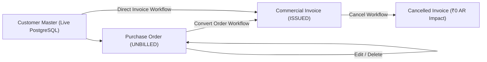

# CollectFlow — Stage 4C.3 Implementation Plan
## Orders, Invoices & Statutory Conversion Engine

**Status:** APPROVED FOR IMPLEMENTATION  
**Target Branches:** `feature/phase4-stage4c3-orders-invoices` (Both Repositories)  
**Backend Approved Baseline:** `5f03d66f79610c2a696c73c77a131a16d1ef9837`  
**Frontend Approved Baseline:** `233b6e356c3d134f6b8ad4e1377bef1ac6218da7`  

---

## 1. Executive Summary & Architectural Scope

Stage 4C.3 implements authoritative PostgreSQL-backed domain services and live frontend integration for **Purchase Orders**, **Commercial Tax Invoices**, **PO-to-Invoice Statutory Conversion**, and **Legal Cancellation**.

The existing Phase 3 interface and the frozen Phase 4 contracts (`docs/contracts/v1/openapi.yaml`, `app/models/domain_models.py`, `src/data/orders.ts`) are the authoritative reference baselines.

---

## 2. API Contract Mapping & Router Architecture

The implementation replaces Phase 3 legacy SQLite handlers in LIVE mode with authoritative PostgreSQL 16 domain routers.

### 2.1 Purchase Orders Router (`app/routers/orders.py`)

| Endpoint | Method | RBAC | OpenAPI Operation | Description |
|---|---|---|---|---|
| `/api/orders` | `GET` | Authenticated | `ListOrders` | Lists purchase orders filtered by FY, customer, status, pagination. |
| `/api/orders/{id}` | `GET` | Authenticated | `GetOrder` | Detailed purchase order view with line items. |
| `/api/orders` | `POST` | `admin`, `finance`, `sales` | `RegisterOrder` | Creates a new purchase order with line items and financial totals. |
| `/api/orders/{id}` | `PUT` | `admin`, `finance`, `sales` | `UpdateOrder` | Edits an unbilled purchase order. Strictly rejects converted/cancelled orders. |
| `/api/orders/{id}` | `DELETE` | `admin`, `finance` | `DeleteOrder` | Deletes an unbilled purchase order and cascades line items. |
| `/api/orders/{id}/convert`| `POST` | `admin`, `finance` | `ConvertOrder` | Converts unbilled PO to an issued commercial invoice with customer snapshot. |

### 2.2 Commercial Invoices Router (`app/routers/invoices.py`)

| Endpoint | Method | RBAC | OpenAPI Operation | Description |
|---|---|---|---|---|
| `/api/invoices` | `GET` | Authenticated | `ListInvoices` | Lists commercial invoices with line items and settlement summaries. |
| `/api/invoices/{id}` | `GET` | Authenticated | `GetInvoice` | Full invoice detail including line items, settlements, and customer snapshot. |
| `/api/invoices` | `POST` | `admin`, `finance` | `CreateDirectInvoice`| Direct invoice issuance (Recurring / Direct Billing) with customer snapshot. |
| `/api/invoices/{id}/cancel`| `POST`| `admin`, `finance` | `CancelInvoice` | Legally cancels unpaid invoice with mandatory reason and atomic audit log. |

---

## 3. Database Domain Models & Migrations

All 4 core domain tables are already established in PostgreSQL under revision `e9ee322f8b96`:
- `purchase_orders`: Tracks `fy_code`, `po_number`, `customer_id`, `executive_id`, `currency`, `exchange_rate`, `exclusive_amount`, `tax_rate`, `tax_amount`, `total_amount`, `status` (`UNBILLED`, `CONVERTED`, `CANCELLED`).
- `purchase_order_items`: Line items with `quantity`, `unit_price`, `exclusive_amount`, `tax_rate`, `tax_amount`, `total_amount`.
- `commercial_invoices`: Issued receivables with immutable customer snapshots (`snapshot_customer_name`, `snapshot_gstin`, `snapshot_billing_address`, `snapshot_state`), GST breakdown (`cgst_amount`, `sgst_amount`, `igst_amount`), and lifecycle (`ISSUED`, `CANCELLED`).
- `commercial_invoice_items`: Issued line items matching approved tax breakdown.

No structural schema migrations are required; the tables and check constraints already exist in PostgreSQL 16.

---

## 4. Financial Invariants & Conversion Engine

1. **Python Decimal Arithmetic:** All monetary fields use `Decimal` with `ROUND_HALF_UP`. No floating-point math for money.
2. **Exact String Serialization:** Monetary amounts in API JSON responses are formatted as exact two-decimal strings (e.g. `"531000.00"`, `"295000.00"`).
3. **Statutory GST Allocation Engine:**
   - Home state is Karnataka (`KA` / `29` / `Karnataka`).
   - Intra-state transaction (`customer.state == "Karnataka"`):
     $$\text{CGST} = \text{round}\left(\frac{\text{tax\_amount}}{2}, 2\right), \quad \text{SGST} = \text{round}\left(\frac{\text{tax\_amount}}{2}, 2\right), \quad \text{IGST} = 0.00$$
   - Inter-state transaction (`customer.state != "Karnataka"`):
     $$\text{IGST} = \text{tax\_amount}, \quad \text{CGST} = 0.00, \quad \text{SGST} = 0.00$$
4. **Immutable Customer Snapshot:**
   When an invoice is issued (via conversion or direct invoice), the customer's legal name, GSTIN, billing address, and state are snapshotted into `commercial_invoices`. Subsequent updates to the customer record never mutate issued invoices.
5. **Net 30 Due Date Default:**
   If `due_date` is omitted during PO conversion or direct invoice creation, default to exactly `invoice_date + 30 days`.
6. **Unbilled PO Exclusion:**
   Unbilled purchase orders represent pre-billing operational commitments and contribute ₹0 to issued receivables (`total_billed`) and ₹0 to recognized Accounts Receivable (`total_outstanding`).
7. **Safe Cancellation Invariant:**
   Cancellation is permitted only if the invoice has zero active settlements (`sum(total_settled) == 0`). Cancelled invoices contribute ₹0 to outstanding receivables.

---

## 5. Frontend LIVE Mode Integration

1. **`ApiClient` Extensions (`src/lib/api-client.ts`):**
   - `getOrders(params)` / `getOrder(id)` / `createOrder(data)` / `updateOrder(id, data)` / `deleteOrder(id)` / `convertOrder(id, data)`
   - `getInvoices(params)` / `getInvoice(id)` / `createInvoice(data)` / `cancelInvoice(id, data)`
2. **Workspace Screen Wiring (`src/components/collectflow/workspace.tsx`):**
   - In LIVE mode, fetch real `PurchaseOrder` and `CommercialInvoice` records from backend.
   - Authorize "New Order" button for `admin`, `finance`, and `sales`.
   - Pass live records to `RecordList`.
3. **Order Workflows (`src/components/collectflow/order-workflows.tsx`):**
   - Connect `order-create`, `order-edit`, `order-convert`, and `order-delete` to `apiClient`.
   - Preserve Form → Review → Confirm → Result pattern.
   - Prevent duplicate submissions via `pending` and `submitting` guards.
4. **Cancellation Drawer (`src/components/collectflow/cancel-workflow.tsx`):**
   - Connect `handleConfirm` to `apiClient.cancelInvoice(invoice.id, { reason })`.
   - Render strict warning and disable submission if invoice has recorded payments.
5. **MOCK Mode Preservation:**
   - All Phase 3 mock session behaviors remain untouched when `VITE_API_MODE=mock`.

---

## 6. Concurrency, Locking & RBAC Matrix

| Role | PO List/Detail | PO Create | PO Edit (Unbilled) | PO Delete (Unbilled) | PO Convert | Invoice Create | Invoice Cancel |
|---|---|---|---|---|---|---|---|
| **admin** | Allowed | Allowed | Allowed | Allowed | Allowed | Allowed | Allowed |
| **finance** | Allowed | Allowed | Allowed | Allowed | Allowed | Allowed | Allowed |
| **sales** | Allowed | Allowed | Allowed | Blocked (403) | Blocked (403) | Blocked (403) | Blocked (403) |
| **viewer** | Allowed | Blocked (403) | Blocked (403) | Blocked (403) | Blocked (403) | Blocked (403) | Blocked (403) |

**Advisory & Row Locking:**
- PO Conversion uses `SELECT * FROM purchase_orders WHERE id = :id FOR UPDATE` to prevent concurrent double-conversion.
- Invoice Cancellation uses `SELECT * FROM commercial_invoices WHERE id = :id FOR UPDATE` and checks `payment_transactions` within the same transaction.

---

## 7. Implementation Sequence

1. **Phase 1: Backend Domain Routers**
   - Implement `app/routers/orders.py` (PostgreSQL domain router).
   - Refactor `app/routers/invoices.py` from legacy SQLite to authoritative PostgreSQL domain router.
   - Register routes in `app/main.py`.
2. **Phase 2: Backend Pytest Automated Test Suite**
   - Implement comprehensive Stage 4C.3 tests in `tests/test_stage4c3_orders_invoices.py`.
   - Verify all 12 core test areas.
3. **Phase 3: Frontend API Client & Component Wiring**
   - Extend `src/lib/api-client.ts`.
   - Update `src/components/collectflow/order-workflows.tsx` and `workspace.tsx`.
   - Update `src/components/collectflow/cancel-workflow.tsx`.
4. **Phase 4: Frontend Tests & Playwright UAT**
   - Vitest component tests in `src/test/orders-invoices-live.test.tsx`.
   - Playwright live browser test suite `e2e/stage4c3-orders-invoices-uat.spec.ts`.
5. **Phase 5: Review Documentation & GitHub Push**
   - Generate `docs/reviews/COLLECTFLOW_STAGE4C3_IMPLEMENTATION_REPORT.md`.
   - Fast-forward push both feature branches to GitHub.

---

## 8. Stage Boundaries & Strict Exclusions

- **OUT OF SCOPE:** Payment creation, payment reversals, TDS section allocation (Stage 4C.4).
- **OUT OF SCOPE:** AR Aging calculation engine, Sales targets, Excel/CSV exports (Stage 4C.5).
- **OUT OF SCOPE:** Cloud hosting, public tunnels, production infrastructure.
