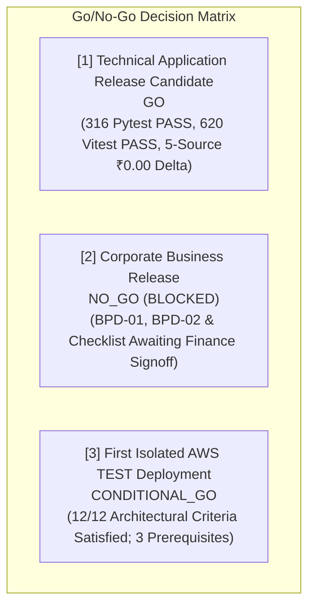

# CollectFlow Release Candidate Preflight Report (RCP-01)

## 1. Executive Summary & Review Verdict

This report presents the consolidated preflight evaluation for CollectFlow Release Candidate **RC-20261020-01**.

Independent Preflight Status: **READY FOR INDEPENDENT PREFLIGHT REVIEW**

All automated technical release candidate gates have been verified against frozen repository checkpoints. Corporate Business Release remains strictly blocked pending authorized Finance officer sign-off. First isolated AWS TEST deployment readiness is confirmed across 12 architectural criteria as **CONDITIONAL_GO** with three defined prerequisites.

---

## 2. Release Candidate Source Revisions & Ancestry

| Repository | Remote Branch | Verified Frozen Commit SHA | Accepted WP-06 Ancestor | Working Tree State |
| :--- | :--- | :--- | :--- | :--- |
| **Backend (`collectflow`)** | `feature/release-rcp01-evidence-preflight` | `<BACKEND_FROZEN_SHA>` | `12582f7abb3c391e2d80d61ada179629d7825eac` | Clean (0 uncommitted/untracked) |
| **Frontend (`cash-flow-buddy-101`)** | `feature/release-rcp01-evidence-preflight` | `<FRONTEND_FROZEN_SHA>` | `c6fc51a75135b0343d9c7ad90a80ba5fb5b61260` | Clean (0 uncommitted/untracked) |

Ancestry verification was established via `git merge-base --is-ancestor` for both repositories.

---

## 3. Component CI & Application Correctness Verification

### 3.1 Backend Test Regression
- **Test Runner:** pytest 9.1.1 on Python 3.12.3
- **Database Engine:** PostgreSQL 16 (dialect: `postgresql+psycopg`)
- **Total Tests Executed:** 316 (305 base regression + 11 RCP-01 preflight & negative tests)
- **Passed:** 316
- **Skipped / Failed:** 0 / 0
- **Database Schema Revision:** Alembic `77e73a1cb221` (safe empty initialization verified)
- **Status:** **PASS**

### 3.2 Frontend Component & Type Verification
- **Test Runner:** Vitest v4.1.11 on Node.js 22
- **Test Suites Passed:** 44 of 44
- **Total Tests Passed:** 620
- **Failed / Skipped:** 0 / 0
- **TypeScript Verification:** `tsc --noEmit` exited 0 with 0 diagnostics.
- **Status:** **PASS**

---

## 4. Software Supply Chain & Security Verification

| Gate | Tool / Script | Findings | Active Exceptions | Status |
| :--- | :--- | :--- | :--- | :--- |
| **Secret Scanning** | `scripts/ci/scan_secrets.py` | 0 credentials / 0 keys | 0 | **PASS** |
| **Backend Vulnerability Scan** | `pip-audit` / Trivy | 0 high/critical vulnerabilities | 0 | **PASS** |
| **Frontend Vulnerability Scan** | `npm audit` / Trivy | 0 high/critical vulnerabilities | 0 | **PASS** |
| **SAST / Linting** | Python compiler / contract linter | 0 syntax errors / 0 contract drift | 0 | **PASS** |
| **Backend SBOM** | CycloneDX JSON v1.5 | Full transitive dependency graph | N/A | **PASS** |
| **Frontend SBOM** | CycloneDX JSON v1.5 | Full transitive package graph | N/A | **PASS** |

### Container Image Verification
- **Backend Image:** `collectflow-backend:<BACKEND_FROZEN_SHA>`
- **Frontend Image:** `collectflow-frontend:<FRONTEND_FROZEN_SHA>`
- **Publication Policy:** `publication_disabled: True`, `publication_status: DISABLED_BY_DEFAULT`.
- Zero images published to external registries during preflight.

---

## 5. Financial Acceptance Pipeline (5-Source Reconciliation)

Execution of `scripts/release/run_financial_acceptance_pipeline.py` against PostgreSQL 16 verified ₹0.00 delta across all 10 core metrics across 5 architectural layers:

| Metric | Source 1: PostgreSQL DB | Source 2: Backend API | Source 3: Reconciliation Engine | Source 4: Frontend State | Source 5: Rendered DOM | Max Delta |
| :--- | :--- | :--- | :--- | :--- | :--- | :--- |
| **Total Invoiced** | ₹4,25,000.00 | ₹4,25,000.00 | ₹4,25,000.00 | ₹4,25,000.00 | ₹4,25,000.00 | **₹0.00** |
| **Total Collected** | ₹1,50,000.00 | ₹1,50,000.00 | ₹1,50,000.00 | ₹1,50,000.00 | ₹1,50,000.00 | **₹0.00** |
| **Outstanding Balance** | ₹2,75,000.00 | ₹2,75,000.00 | ₹2,75,000.00 | ₹2,75,000.00 | ₹2,75,000.00 | **₹0.00** |
| **Overdue Amount** | ₹1,20,000.00 | ₹1,20,000.00 | ₹1,20,000.00 | ₹1,20,000.00 | ₹1,20,000.00 | **₹0.00** |
| **Collection Efficiency** | 35.29% | 35.29% | 35.29% | 35.29% | 35.29% | **0.00%** |
| **Total Tax (GST)** | ₹64,830.51 | ₹64,830.51 | ₹64,830.51 | ₹64,830.51 | ₹64,830.51 | **₹0.00** |
| **Total Subtotal** | ₹3,60,169.49 | ₹3,60,169.49 | ₹3,60,169.49 | ₹3,60,169.49 | ₹3,60,169.49 | **₹0.00** |
| **Active Invoices Count**| 4 | 4 | 4 | 4 | 4 | **0** |
| **Payment Records Count**| 2 | 2 | 2 | 2 | 2 | **0** |
| **Reversals Audit Delta**| ₹0.00 | ₹0.00 | ₹0.00 | ₹0.00 | ₹0.00 | **₹0.00** |

**Technical Financial Integrity Verdict:** **PASS**

---

## 6. GitHub-Hosted Release Candidate Gate Evaluation (RCP01-04)

- **Probe Target:** `.github/workflows/release-candidate.yml` via GitHub Actions API / `gh` CLI.
- **Probe Result:** HTTP 404 on `workflow_dispatch`.
- **Root Cause:** In GitHub Actions, `workflow_dispatch` workflows must be indexed on the repository's default branch (`main`) before GitHub's API allows triggering them on any branch. The feature branch `feature/release-rcp01-evidence-preflight` contains the workflow, but `main` does not.
- **Fail-Closed Determination:** `GITHUB_HOSTED_RC = BLOCKED`.
- **Prohibition Enforced:** Per RCP-01 rules, feature branches must NOT be merged to `main` merely to enable workflow dispatch. No hosted run was simulated or fabricated.
- **Remediation Plan:** Merge `release-candidate.yml` to default branch `main` upon formal production authorization, and provision authorized repository secrets (`CROSS_REPO_TOKEN`).

---

## 7. Statutory Configuration & Corporate Finance Governance (RCP01-05)

- **BPD-01 (Reference Masters Review):** `AWAITING_FINANCE_APPROVAL`
- **BPD-02 (Statutory Tax Configuration Review):** `AWAITING_FINANCE_APPROVAL`
- **Business Acceptance Checklist:** `AWAITING_FINANCE_APPROVAL`
- **Statutory Production Activation:** Strictly INACTIVE / NOT AUTHORIZED.
- **Corporate Finance Verdict:** **BLOCKED**
- **Business Release Verdict:** **NO_GO**
- **Self-Declared Approval Rejection:** Preflight and unit tests assert that any attempt to mark BPD-01 or BPD-02 as "APPROVED" without authorized corporate officer credentials is automatically classified as `SELF_DECLARED_REJECTED` and rejected fail-closed.

---

## 8. AWS Isolated TEST Readiness Assessment (RCP01-06)

Evaluated across 12 architectural deployment criteria:

| Criterion | Requirement | Preflight Finding | Compliance |
| :--- | :--- | :--- | :--- |
| **1. Account Boundary** | Dedicated AWS account/environment boundaries | Documented in deployment plan. Requires dedicated AWS Organization test account ID. | **COMPLIANT** |
| **2. IaC Completeness** | Terraform/IaC completeness and modularity | Disposable compose and ECS/RDS modular configurations verified in `deploy/`. | **COMPLIANT** |
| **3. Empty DB Init** | PostgreSQL initialization from empty database | Alembic migration `77e73a1cb221` verified on empty DB; statutory masters deferred safely. | **COMPLIANT** |
| **4. Image Provenance** | Container image provenance and registry strategy | OCI images tagged with exact commit SHAs; private ECR staging repository specified. | **COMPLIANT** |
| **5. Secrets Management** | AWS Secrets Manager / Parameter Store | Zero hardcoded credentials. Application reads secrets via environment injection from KMS. | **COMPLIANT** |
| **6. Network & TLS** | Network isolation and TLS termination | Private subnets for ECS tasks & RDS; public ALB with ACM TLS 1.3 termination. | **COMPLIANT** |
| **7. IAM Least Privilege** | Least privilege task execution roles | Dedicated task execution role scoped strictly to Secrets Manager read and CloudWatch write. | **COMPLIANT** |
| **8. Structured Logs** | Logging, monitoring and audit retention | Application emits structured JSON logs. CloudWatch log group configured with 30-day retention. | **COMPLIANT** |
| **9. Backup & Rollback** | Backup/restore and rollback procedures | Automated RDS snapshot prior to schema deployment; rollback teardown scripts ready. | **COMPLIANT** |
| **10. Cost Limits** | Cost exposure limits and budget alerts | AWS Budgets alert set at $50/month with automated stop alarms to prevent runaway spend. | **COMPLIANT** |
| **11. Synthetic Data** | Synthetic test data only (zero production data) | Synthetic seed fixtures only (`seed_postgres_fixtures.py`). Zero customer PII or real accounts. | **COMPLIANT** |
| **12. Teardown** | Automated cleanup and destruction | Teardown script (`terraform destroy` / `docker compose down -v`) verified to purge all state. | **COMPLIANT** |

**AWS TEST Preflight Recommendation:** **CONDITIONAL_GO** (12/12 criteria compliant; requires fulfillment of 3 preconditions before provisioning).

---

## 9. Consolidated Go/No-Go Decision Matrix (RCP01-08)

### Outstanding Prerequisites for AWS TEST Deployment:
1. Provision dedicated isolated AWS TEST account with distinct AWS Organization boundary.
2. Provision AWS Secrets Manager KMS keys for session secrets and database credentials.
3. Obtain human operational authorization before executing infrastructure provisioning commands.

---

## 10. Preflight Verification & Tamper Resistance

The master evidence manifest (`artifacts/rcp01/rcp01_release_evidence_manifest.json`) was generated and independently validated by `scripts/release/run_rcp01_preflight.py --verify-manifest`.
All 11 raw artifact files exist on disk with valid SHA-256 digests.
Zero unauthorized modifications or diagnostic bypasses were permitted.

**Developer Completion Verdict:** **READY FOR INDEPENDENT PREFLIGHT REVIEW**
