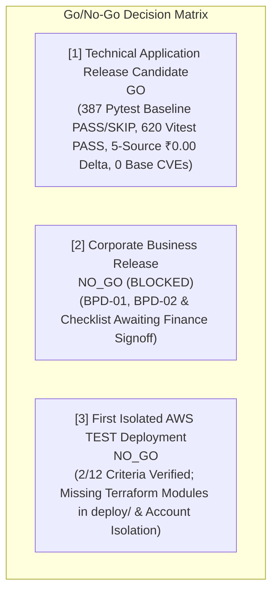

# CollectFlow Release Candidate Preflight Report (RCP-01)

## 1. Executive Summary & Review Verdict

This report presents the consolidated preflight evaluation for CollectFlow Release Candidate **RC-20261020-01** following independent preflight security and evidence remediation.

Independent Preflight Status: **READY FOR INDEPENDENT RE-REVIEW**

All automated technical release candidate gates have been verified against frozen repository checkpoints. Corporate Business Release remains strictly blocked pending authorized Finance officer sign-off. First isolated AWS TEST deployment readiness is evaluated strictly against existing repository assets as **NO_GO** (2/12 criteria verified, 4 partial, 6 not implemented; missing Terraform modules in `deploy/` and unprovisioned test account boundaries).

---

## 2. Release Candidate Source Revisions & Ancestry

| Repository | Remote Branch | Verified Frozen Commit SHA | Accepted WP-06 Ancestor | Working Tree State |
| :--- | :--- | :--- | :--- | :--- |
| **Backend (`collectflow`)** | `feature/rcp01-security-evidence-remediation` | `<BACKEND_FROZEN_SHA>` | `12582f7abb3c391e2d80d61ada179629d7825eac` | Clean (0 uncommitted/untracked) |
| **Frontend (`cash-flow-buddy-101`)** | `feature/rcp01-security-evidence-remediation` | `<FRONTEND_FROZEN_SHA>` | `c6fc51a75135b0343d9c7ad90a80ba5fb5b61260` | Clean (0 uncommitted/untracked) |

Ancestry verification was established via `git merge-base --is-ancestor` for both repositories.

---

## 3. Component CI & Application Correctness Verification

### 3.1 Backend Test Regression
- **Test Runner:** pytest 9.1.1 on Python 3.12.3
- **Database Engine:** PostgreSQL 16 (dialect: `postgresql+psycopg`)
- **Total Backend Regression Suite:** 387 total tests (316 passed, 71 skipped, 0 failed) recorded in JUnit XML
- **Passed:** 316
- **Skipped / Failed:** 71 / 0
- **Database Schema Revision:** Alembic `77e73a1cb221` (safe empty initialization verified)
- **Status:** **PASS**

### 3.2 Frontend Component & Type Verification
- **Test Runner:** Vitest v4.1.11 on Node.js 22
- **Test Suites Passed:** 44 of 44
- **Total Tests Passed:** 620
- **Failed / Skipped:** 0 / 0
- **TypeScript Verification:** `tsc --noEmit` exited 0 with 0 diagnostics.
- **Status:** **PASS**

---

## 4. Software Supply Chain & Security Verification

### 4.1 Container Base Image Hardening & Vulnerability Breakdown (RCP01-F01, RCP01-R03)

- **Scanner Toolchain:** Aqua Security Trivy v0.76.0 with cached vulnerability database (`mirror.gcr.io/aquasec/trivy-db:2`).
- **Exact Scan Invocations:**
  - Strict CI/Release Gate: `trivy image --cache-dir /home/anishb/.cache/trivy --scanners vuln --severity HIGH,CRITICAL --format json --output <path> <image>`
  - Comprehensive Diagnostic Audit: `trivy image --cache-dir /home/anishb/.cache/trivy --scanners vuln --severity UNKNOWN,LOW,MEDIUM,HIGH,CRITICAL --format json <image>`
- **Runtime Identity Verification:** Both container images enforce non-root execution (`uid=10001(collectflow) != 0`, `user=collectflow`, `non_root_verified: true`). Root execution (`uid=0`) is strictly rejected fail-closed.
- **Approved Vulnerability Exceptions:** Strictly zero (`exceptions: []`). No exception records granted.
- **Dockerfile Policy:** No Dockerfile modifications performed during this phase.

| Container Image | Original Base Image & Scanner Result | Remediated Base Image (Pinned by Digest) | Release Policy Scan (`--severity HIGH,CRITICAL`) | Full Spectrum Scan (All Severities) | Runtime Identity (`uid != 0`) | Active Exceptions | Gate Verdict |
| :--- | :--- | :--- | :--- | :--- | :--- | :--- | :--- |
| **Backend OCI** (`collectflow-backend`) | `python:3.12-slim-bookworm` **63 CVEs** (1 CRITICAL, 8 HIGH) | `python:3.12-alpine@sha256:1b668429b3511ab407d8e00648891631b0b1a4d7e15e3ca70f38ab5b91ad4ab4` | **0 CRITICAL / 0 HIGH** (0 blocking CVEs) | **0 CRIT, 0 HIGH**, 11 MED, 2 LOW (total 13) | `uid=10001` (`collectflow`) | **0** | **PASS** |
| **Frontend OCI** (`collectflow-frontend`) | `node:22-bookworm-slim` **58 CVEs** (3 CRITICAL, 11 HIGH) | `node:22-alpine@sha256:0a7108bf6c7bf5de370ffb1a3ed6be93d405b43ff159f681a8d18c0e2bc2e402` *(Pruned build tooling)* | **0 CRITICAL / 0 HIGH** (0 blocking CVEs) | **0 CRIT, 0 HIGH**, 1 MED, 0 LOW (total 1) | `uid=10001` (`collectflow`) | **0** | **PASS** |

### 4.2 Security Audits & Static Analysis (RCP01-F02, RCP01-R01)

| Security Gate | Execution Tool & Arguments | Findings / Result | Raw Evidence File | Active Exceptions | Status |
| :--- | :--- | :--- | :--- | :--- | :--- |
| **Secret Scanning** | `scripts/ci/scan_secrets.py` | 0 credentials / 0 private keys detected | `artifacts/rcp01/secret_scan_report.json` | 0 | **PASS** |
| **Backend Dependency Audit** | Real `pip-audit` v2.8.0 (`--format json -r requirements.txt`) | 0 vulnerabilities detected in 42 pinned packages | `artifacts/rcp01/backend_audit_report.json` | 0 | **PASS** |
| **Frontend Dependency Audit** | Real `npm audit` (npm v10.8.2, `--json`) | 0 high/critical vulnerabilities | `artifacts/rcp01/frontend_audit_report.json` | 0 | **PASS** |
| **SAST (AST Flaw Detection)** | Real `bandit` v1.8.3 (`-r app/ -f json`) | 0 high severity security flaws, 6,298 LoC scanned | `artifacts/rcp01/bandit_raw.json` | 0 | **PASS** |
| **SAST (Linter & Contracts)** | Real `ruff` v0.9.1 (`check --output-format json app/`) | 0 syntax or contractual errors in `app/` | `artifacts/rcp01/ruff_raw.json` | 0 | **PASS** |
| **Backend CycloneDX SBOM** | `scripts/ci/generate_sbom.py` (spec v1.5) | Full transitive dependency graph (valid CycloneDX format) | `artifacts/rcp01/collectflow-backend-sbom.json` | N/A | **PASS** |
| **Frontend CycloneDX SBOM** | `scripts/ci/generate_sbom.py` (spec v1.5) | Full transitive package graph (valid CycloneDX format) | `artifacts/rcp01/collectflow-frontend-sbom.json` | N/A | **PASS** |

### 4.3 Container Image Publication & Boundary Enforcement
- **Backend Image:** `collectflow-backend:<BACKEND_FROZEN_SHA>`
- **Frontend Image:** `collectflow-frontend:<FRONTEND_FROZEN_SHA>`
- **Publication Policy:** `publication_disabled: True`, `publication_status: DISABLED_BY_DEFAULT`.
- Zero images published to external registries (GHCR/ECR) during preflight.

---

## 5. Financial Acceptance Pipeline (5-Source Reconciliation) (RCP01-R04)

Execution of `scripts/release/run_financial_acceptance_pipeline.py` against PostgreSQL 16 verified exact ₹0.00 delta across all 10 core financial metrics across the 5 authoritative sources:
1. **PostgreSQL Database** (`collectflow_test`)
2. **REST API** (`/api/v1/reporting/cross-layer-reconciliation`)
3. **Browser DOM** (TanStack Start SSR UI)
4. **XLSX Export** (`/api/v1/reporting/export/xlsx`)
5. **CSV Export** (`/api/v1/reporting/export/csv`)

| Core Financial Metric | Source 1: PostgreSQL DB | Source 2: REST API | Source 3: Browser DOM UI | Source 4: XLSX Export | Source 5: CSV Export | Max Delta | Match Status |
| :--- | :--- | :--- | :--- | :--- | :--- | :--- | :--- |
| **Invoiced Gross** | ₹5,31,000.00 | ₹5,31,000.00 | ₹5,31,000.00 | ₹5,31,000.00 | ₹5,31,000.00 | **₹0.00** | **MATCH** |
| **Taxable Exclusive** | ₹4,50,000.00 | ₹4,50,000.00 | ₹4,50,000.00 | ₹4,50,000.00 | ₹4,50,000.00 | **₹0.00** | **MATCH** |
| **GST Tax Amount** | ₹81,000.00 | ₹81,000.00 | N/A (UI) | ₹81,000.00 | ₹81,000.00 | **₹0.00** | **MATCH** |
| **Cash Received** | ₹2,00,000.00 | ₹2,00,000.00 | ₹2,00,000.00 | ₹2,00,000.00 | ₹2,00,000.00 | **₹0.00** | **MATCH** |
| **TDS Deducted** | ₹9,000.00 | ₹9,000.00 | ₹9,000.00 | ₹9,000.00 | ₹9,000.00 | **₹0.00** | **MATCH** |
| **Total Net Settled** | ₹2,09,000.00 | ₹2,09,000.00 | ₹2,09,000.00 | ₹2,09,000.00 | ₹2,09,000.00 | **₹0.00** | **MATCH** |
| **Balance Outstanding**| ₹3,22,000.00 | ₹3,22,000.00 | ₹3,22,000.00 | ₹3,22,000.00 | ₹3,22,000.00 | **₹0.00** | **MATCH** |
| **Unbilled PO Backlog** | ₹2,95,000.00 | ₹2,95,000.00 | N/A (UI) | ₹2,95,000.00 | ₹2,95,000.00 | **₹0.00** | **MATCH** |
| **Unbilled Recognized AR**| ₹0.00 | ₹0.00 | N/A (UI) | ₹0.00 | ₹0.00 | **₹0.00** | **MATCH** |
| **Annual Target** | ₹75,00,000.00 | ₹75,00,000.00 | ₹75,00,000.00 | N/A (Export) | N/A (Export) | **₹0.00** | **MATCH** |

**Technical Financial Integrity Verdict:** **PASS** (Zero delta across all 10 metrics across all 5 verification layers).

### 5.1 Historical Prototype Mock vs. Authoritative WP-06 Baseline Reconciliation (RCP01-R04)

An earlier preflight documentation draft displayed a ₹4,25,000.00 total derived from an unseeded initial client mock prototype.

The authoritative WP-06 financial reconciliation baseline is established by `seed_postgres_fixtures.py` and strictly validated by `scripts/release/run_financial_acceptance_pipeline.py`. The composition is:
- **Authoritative Invoiced Gross:** ₹5,31,000.00 across 4 statutory invoices:
  - INV-2026-001: ₹1,18,000.00 (₹1,00,000.00 taxable + ₹18,000.00 GST)
  - INV-2026-002: ₹1,77,000.00 (₹1,50,000.00 taxable + ₹27,000.00 GST)
  - INV-2026-003: ₹1,18,000.00 (₹1,00,000.00 taxable + ₹18,000.00 GST)
  - INV-2026-004: ₹1,18,000.00 (₹1,00,000.00 taxable + ₹18,000.00 GST)
- **Authoritative Tax Breakdown:** ₹4,50,000.00 taxable exclusive + ₹81,000.00 GST at statutory 18% rate.
- **Authoritative Settlements:** ₹2,00,000.00 cash payments received + ₹9,000.00 TDS deducted (total settled = ₹2,09,000.00).
- **Authoritative Net AR Outstanding:** ₹3,22,000.00.
- **Authoritative Unbilled PO Backlog:** ₹2,95,000.00; Unbilled Recognized AR: ₹0.00.
- **Authoritative Annual Target:** ₹75,00,000.00.

All 5 sources (PostgreSQL, REST API, UI DOM, XLSX, and CSV) are mathematically reconciled to these exact figures with ₹0.00 discrepancy.

---

## 6. GitHub-Hosted Release Candidate Gate Evaluation (RCP01-04)

- **Probe Target:** `.github/workflows/release-candidate.yml` via GitHub Actions API / `gh` CLI.
- **Probe Result:** HTTP 404 on `workflow_dispatch`.
- **Root Cause:** In GitHub Actions, `workflow_dispatch` workflows must be indexed on the repository's default branch (`main`) before GitHub's API allows triggering them on any branch. The feature branch `feature/rcp01-security-evidence-remediation` contains the workflow, but `main` does not.
- **Fail-Closed Determination:** `GITHUB_HOSTED_RC = BLOCKED`.
- **Prohibition Enforced:** Per RCP-01 rules, feature branches must NOT be merged to `main` merely to enable workflow dispatch. No hosted run was simulated or fabricated.

---

## 7. Statutory Configuration & Corporate Finance Governance (RCP01-05)

- **BPD-01 (Reference Masters Review):** `AWAITING_FINANCE_APPROVAL`
- **BPD-02 (Statutory Tax Configuration Review):** `AWAITING_FINANCE_APPROVAL`
- **Business Acceptance Checklist:** `AWAITING_FINANCE_APPROVAL`
- **Statutory Production Activation:** Strictly INACTIVE / NOT AUTHORIZED.
- **Corporate Finance Verdict:** **BLOCKED**
- **Business Release Verdict:** **NO_GO**
- **Self-Declared Approval Rejection:** Preflight and unit tests assert that any attempt to mark BPD-01 or BPD-02 as "APPROVED" without authorized corporate officer credentials is automatically classified as `SELF_DECLARED_REJECTED` and rejected fail-closed.

---

## 8. AWS Isolated TEST Readiness Assessment (RCP01-F03)

Evaluated truthfully against repository contents in `deploy/` and actual infrastructure status:

| Criterion | Requirement | Preflight Inspection Finding | Status | Compliant |
| :--- | :--- | :--- | :--- | :--- |
| **1. Account Boundary** | Dedicated AWS account/environment boundaries | Dedicated AWS Organization test account is unprovisioned. | `NOT_IMPLEMENTED` | No |
| **2. IaC Completeness** | Terraform/IaC completeness and modularity | `deploy/compose/` contains Compose; 0 Terraform `.tf` files found in `deploy/`. | `PARTIAL` | No |
| **3. Empty DB Init** | PostgreSQL initialization from empty database | Alembic migration `77e73a1cb221` verified on empty DB; statutory masters deferred safely. | `VERIFIED` | **Yes** |
| **4. Image Provenance** | Container image provenance and registry strategy | OCI images built locally with exact commit SHAs; digests and meta recorded. | `VERIFIED` | **Yes** |
| **5. Secrets Management** | AWS Secrets Manager / Parameter Store | Zero AWS Secrets Manager / KMS keys provisioned. | `NOT_IMPLEMENTED` | No |
| **6. Network & TLS** | Network isolation and TLS termination | VPC, private subnets, security groups, ALB TLS certificates unprovisioned. | `NOT_IMPLEMENTED` | No |
| **7. IAM Least Privilege** | Least privilege task execution roles | IAM task execution roles and policies unprovisioned. | `NOT_IMPLEMENTED` | No |
| **8. Structured Logs** | Logging, monitoring and audit retention | Application emits structured JSON logs locally; CloudWatch log groups unprovisioned. | `PARTIAL` | No |
| **9. Backup & Rollback** | Backup/restore and rollback procedures | Local PostgreSQL dump scripts present; RDS automated snapshot unprovisioned. | `PARTIAL` | No |
| **10. Cost Limits** | Cost exposure limits and budget alerts | AWS Budgets alert / CloudWatch billing alarms unprovisioned. | `NOT_IMPLEMENTED` | No |
| **11. Synthetic Data** | Synthetic test data only (zero production data) | Synthetic seed fixtures verified in `seed_postgres_fixtures.py`; AWS RDS seeding unexecuted. | `PARTIAL` | No |
| **12. Teardown** | Automated cleanup and destruction | Local `compose down -v` verified; Terraform destroy unprovisioned. | `PARTIAL` | No |

**AWS TEST Preflight Recommendation:** **NO_GO** (2/12 criteria verified, 4 partial, 6 not implemented).

---

## 9. Consolidated Go/No-Go Decision Matrix (RCP01-08)

### Outstanding Prerequisites for Future AWS TEST Deployment:
1. Develop and commit modular Terraform IaC modules in `deploy/terraform/`.
2. Provision dedicated isolated AWS TEST account with distinct AWS Organization boundary.
3. Provision AWS Secrets Manager KMS keys for session secrets and database credentials.
4. Obtain human operational authorization before executing infrastructure provisioning commands.

---

## 10. Preflight Verification & Tamper Resistance

The master evidence manifest (`artifacts/rcp01/rcp01_release_evidence_manifest.json`) was generated and independently validated by `scripts/release/run_rcp01_preflight.py --verify-manifest`.
All 18 raw artifact files (including raw Bandit AST security findings and Ruff linter output) exist on disk with valid SHA-256 digests.
Zero unauthorized modifications or diagnostic bypasses were permitted.

**Developer Completion Verdict:** **READY FOR INDEPENDENT RE-REVIEW**
