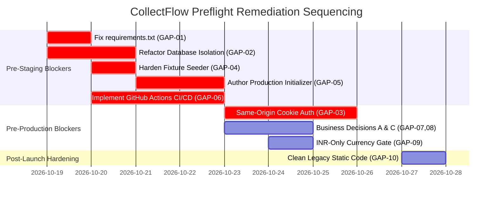

# CollectFlow Post-Phase 4C Release Readiness Gap Assessment

**Document Reference:** `COLLECTFLOW_RELEASE_READINESS_GAP_ASSESSMENT.md`  
**Stage:** Post-Phase 4C Release Readiness Preflight  
**Date:** October 18, 2026  
**Status:** COMPLETE — AUTHORIZED FOR ARCHITECTURE REVIEW  
**Assessment Result:** `NEEDS SECURITY / ARCHITECTURE DECISIONS`  

---

## 1. Executive Summary

This gap assessment provides an evidence-based technical evaluation of the complete PostgreSQL-backed CollectFlow application following the acceptance of Phase 4C (Stage 4C.6).

While the application demonstrates mathematical precision ($\Delta = ₹0.00$), robust transactional row-locking (`with_for_update`), and high test coverage across 39 Playwright scenarios, 115 Pytest cases, and 596 Vitest tests, transitioning from an isolated local test sandbox to an enterprise production environment reveals **10 specific technical and operational gaps**.

Each gap is substantiated by direct source code evidence, evaluated for severity and release impact, and assigned a clear remediation path and go-live blocking status.

---

## 2. Prioritized Gap Matrix

| Gap ID | Domain | Title | Severity | Impact Category | Go-Live Blocking Status | Est. Effort |
|---|---|---|---|---|---|---|
| **GAP-01** | Dependencies | Incomplete Backend `requirements.txt` | **High** | Build Failure | **BLOCKER (Pre-Staging)** | S (1 day) |
| **GAP-02** | Database Engine | Loopback Isolation Blocks Production Environments | **Critical** | Runtime Abort | **BLOCKER (Pre-Staging)** | M (2 days) |
| **GAP-03** | Auth & Session | In-Memory Token Erased on Browser Reload | **High** | User Experience / Auth | **BLOCKER (Pre-Production)** | M (3 days) |
| **GAP-04** | Data Hygiene | Synthetic Fixture Script Lacks Non-Reset Guard | **High** | Data Contamination | **BLOCKER (Pre-Staging)** | S (1 day) |
| **GAP-05** | Provisioning | Missing Production Database Master Initializer | **High** | Deployment Safety | **BLOCKER (Pre-Staging)** | M (2 days) |
| **GAP-06** | CI/CD | Absence of Automated GitHub Actions Workflows | **High** | Automation Mandate | **BLOCKER (Pre-Staging)** | M (3 days) |
| **GAP-07** | Business Logic | Soft Deactivation Ignores Unbilled POs & Receivables | **Medium** | Referential Integrity | **GO-LIVE DECISION** | S (1 day) |
| **GAP-08** | Financial Rules | Missing Accounting Period Locking for Closed FYs | **Medium** | Statutory Compliance | **GO-LIVE DECISION** | M (3 days) |
| **GAP-09** | Financial Rules | Multi-Currency Lacks Realized Forex Gain/Loss Engine | **Medium** | Currency Accounting | **GO-LIVE DECISION** | L (5 days) |
| **GAP-10** | Architecture | Dead Legacy Static Asset Coupling in FastAPI | **Low** | Architectural Hygiene | **POST-LAUNCH HARDENING** | S (0.5 day) |

---

## 3. Detailed Gap Assessments

### GAP-01: Incomplete Backend `requirements.txt` Manifest
- **Description:** The root `requirements.txt` file in the backend repository was created during legacy SQLite prototyping and was never updated during Stage 4C.1 when SQLAlchemy 2.0, PostgreSQL drivers, Alembic, and Argon2id were introduced.
- **Source Evidence:**
  - File: [`collectflow/requirements.txt`](file:///home/anishb/projects/personal/collectflow/requirements.txt#L1-L7)
  - Content:
    ```text
    fastapi==0.142.2
    uvicorn[standard]==0.54.0
    pydantic==2.13.5
    openpyxl==3.1.5
    requests==2.34.2
    httpx==0.28.1
    ```
  - Installed in active `venv` but missing from manifest:
    - `SQLAlchemy==2.1.4`
    - `psycopg==3.3.6`
    - `psycopg-binary==3.3.6`
    - `alembic==1.20.0`
    - `argon2-cffi==25.1.0`
- **Severity:** **High**
- **Release Impact:** Any fresh container build (Docker) or CI runner executing `pip install -r requirements.txt` will immediately crash on startup with `ModuleNotFoundError: No module named 'sqlalchemy'`.
- **Recommended Action:** Update `requirements.txt` (or adopt `pyproject.toml` standard dependencies) with pinned production-ready versions of all required runtime packages.
- **Estimated Relative Effort:** Small (S, 0.5–1 day)
- **Owner / Approval:** Backend Lead
- **Go-Live Blocking Status:** **BLOCKER (Pre-Staging)**

---

### GAP-02: Hardcoded Loopback Isolation Blocks Remote / Production Environments
- **Description:** To ensure strict non-production safety during Stage 4C testing, `app/core/database.py` enforces a rigid whitelist of environment names, database names, and host IP addresses. It explicitly rejects `production` as an environment mode and raises a fatal exception if connecting to any non-loopback host (e.g. AWS RDS or GCP Cloud SQL).
- **Source Evidence:**
  - File: [`collectflow/app/core/database.py`](file:///home/anishb/projects/personal/collectflow/app/core/database.py#L22-L52)
  - Code:
    ```python
    PERMITTED_DEV_DATABASES = {"collectflow_dev", "collectflow_test", "collectflow_sandbox", "collectflow_integration"}
    PERMITTED_LOOPBACK_HOSTS = {"127.0.0.1", "localhost", "::1"}
    PERMITTED_ENV_MODES = {"integration", "sandbox", "test", "development", "dev"}
    ```
  - Lines 124–128:
    ```python
    if host not in PERMITTED_LOOPBACK_HOSTS:
        raise RuntimeError(f"CRITICAL ISOLATION ERROR: Remote host '{url.host}' is prohibited...")
    ```
  - Lines 143–146:
    ```python
    if any(token in db_name.lower() for token in ("prod", "production", "live_prod")):
        raise RuntimeError(f"CRITICAL ISOLATION ERROR: Database '{db_name}' appears to be a production database.")
    ```
- **Severity:** **Critical**
- **Release Impact:** The backend application is physically incapable of running in staging or production. Setting `COLLECTFLOW_ENV=production` or providing an RDS endpoint immediately crashes the application with a `CRITICAL ISOLATION ERROR`.
- **Recommended Action:** Refactor `app/core/database.py` to support a formal `production` mode with dedicated validation rules:
  - Require valid SSL mode (`sslmode=require` or `verify-full`).
  - Require credentials via secure environment variables (`COLLECTFLOW_DATABASE_URL` or AWS Secrets Manager).
  - Retain loopback and name restrictions strictly for `COLLECTFLOW_ENV=test` and `dev`.
- **Estimated Relative Effort:** Medium (M, 2 days)
- **Owner / Approval:** Backend Lead & Security Lead
- **Go-Live Blocking Status:** **BLOCKER (Pre-Staging)**

---

### GAP-03: In-Memory Session Token Erased on Browser Reload
- **Description:** In Stage 4B/4C, session tokens were moved out of `localStorage` into in-memory React state (`ApiClient.inMemoryToken`) to eliminate persistent XSS vulnerability. However, because in-memory state does not survive browser page reloads or tab closures, end-users are forced back to `/login` upon pressing F5, clicking browser reload, or reopening a tab.
- **Source Evidence:**
  - File: [`cash-flow-buddy-101/src/lib/api-client.ts`](file:///home/anishb/projects/personal/cash-flow-buddy-101/src/lib/api-client.ts#L8-L12)
  - Code:
    ```typescript
    // In-memory token storage (ephemeral, not persisted to web storage)
    private inMemoryToken: string | null = null;
    private inMemoryUser: UserProfile | null = null;
    ```
- **Severity:** **High**
- **Release Impact:** Critical user experience friction in production. Financial users navigating between tabs or refreshing reports will constantly lose their session state and unsubmitted drawer inputs.
- **Recommended Action:** Transition to the recommended **Same-Origin Reverse Proxy + `HttpOnly` Cookie** session architecture:
  - Gateway routes `app.collectflow.io/api/*` to backend.
  - Backend issues `Set-Cookie: collectflow_session=<token>; Path=/api; HttpOnly; Secure; SameSite=Lax`.
  - Frontend `ApiClient` sends standard fetch requests with credentials included.
  - Session persists across browser reloads while remaining completely inaccessible to malicious JavaScript.
- **Estimated Relative Effort:** Medium (M, 3 days)
- **Owner / Approval:** Full-Stack Lead & Security Lead
- **Go-Live Blocking Status:** **BLOCKER (Pre-Production)**

---

### GAP-04: Synthetic Baseline Seeding Script Lacks Non-Reset Safety Guard
- **Description:** In Stage 4C.6, a strict safety guard was added to the *reset* branch of `seed_postgres_fixtures.py` (requiring `COLLECTFLOW_ENV=test` and `db_name=collectflow_test`). However, if the script is invoked without the `--reset` flag, the seeder executes without verifying that the target environment is a test database.
- **Source Evidence:**
  - File: [`collectflow/scripts/seed_postgres_fixtures.py`](file:///home/anishb/projects/personal/collectflow/scripts/seed_postgres_fixtures.py#L57-L80)
  - Reset check is enclosed within `if reset:` (line 59).
  - The subsequent insertion of synthetic users (`sandbox_admin`, password `AdminPass123!`), synthetic customers, and test transactions (lines 81–350) has no environment check.
- **Severity:** **High**
- **Release Impact:** An accidental invocation of `python scripts/seed_postgres_fixtures.py` against a staging or production database will inject synthetic test accounts with publicly known passwords and fictitious financial records into real books.
- **Recommended Action:** Wrap the entire `seed_fixtures()` function in an unconditional environment check:
  ```python
  if env_mode != "test" or db_name != "collectflow_test":
      raise RuntimeError("CRITICAL SAFETY ABORT: Synthetic fixtures can only be seeded into 'collectflow_test' with COLLECTFLOW_ENV='test'.")
  ```
- **Estimated Relative Effort:** Small (S, 0.5 day)
- **Owner / Approval:** Backend Lead
- **Go-Live Blocking Status:** **BLOCKER (Pre-Staging)**

---

### GAP-05: Missing Production Database Master Initializer
- **Description:** There is currently no script or procedure for initializing a brand new, empty production database with clean statutory master data (Financial Years, GST rates, TDS sections) without pulling in synthetic accounts and fixtures.
- **Source Evidence:**
  - Absence of `scripts/init_production_db.py`.
  - Existing scripts (`init_sandbox_db.py`, `seed_postgres_fixtures.py`, `import_2026_data.py`) all inject synthetic users or legacy demo fixtures.
- **Severity:** **High**
- **Release Impact:** DevOps engineers deploying to staging or production lack a clean, reproducible database bootstrapping mechanism, creating a risk of manual SQL execution or accidental synthetic seeding.
- **Recommended Action:** Develop `scripts/init_production_db.py`:
  - Applies Alembic migrations (`alembic upgrade head`).
  - Seeds statutory reference masters (active FY 2026-27, GST rates, TDS sections).
  - Bootstraps exactly one primary administrator with a CSPRNG-generated password outputted strictly to secure stdout/Secrets Manager, with `must_change_password=True`.
  - Zero synthetic customers, orders, invoices, or remittances.
- **Estimated Relative Effort:** Medium (M, 1.5 days)
- **Owner / Approval:** DevOps & Backend Lead
- **Go-Live Blocking Status:** **BLOCKER (Pre-Staging)**

---

### GAP-06: Absence of Automated GitHub Actions CI/CD Pipeline Definitions
- **Description:** Neither repository contains a `.github/workflows` directory. All testing (115 Pytest, 596 Vitest, 39 Playwright UAT, cross-layer reconciliation) has been performed manually on a local workstation.
- **Source Evidence:**
  - `collectflow/.github` does not exist (`ls: cannot access '.github': No such file or directory`).
  - `cash-flow-buddy-101/.github` does not exist (`ls: cannot access '.github': No such file or directory`).
- **Severity:** **High**
- **Release Impact:** Violates the authorized automation-first release mandate. Introduces risks of untested code reaching release branches and manual deployment human error.
- **Recommended Action:** Implement GitHub Actions pipelines:
  - `ci.yml`: Automated pull request validation (Ruff, ESLint, TypeScript, Pytest, Vitest).
  - `release.yml`: Ephemeral PostgreSQL 16 container, Playwright LIVE UAT, 5-source reconciliation, Docker build with SLSA provenance, and staging deployment.
- **Estimated Relative Effort:** Medium (M, 3 days)
- **Owner / Approval:** DevOps Lead
- **Go-Live Blocking Status:** **BLOCKER (Pre-Staging)**

---

### GAP-07: Customer Soft-Deactivation Ignores Unbilled POs and Open Receivables
- **Description:** Physical customer deletion (`DELETE /api/customers/{id}`) strictly verifies that no purchase orders or invoices reference the customer. However, soft-deactivation (`PUT /api/customers/{id}` with `is_active=False`) does not check whether the customer has active unbilled purchase orders or open commercial receivables.
- **Source Evidence:**
  - File: [`collectflow/app/routers/customers.py`](file:///home/anishb/projects/personal/collectflow/app/routers/customers.py#L363-L365)
  - Code:
    ```python
    if "is_active" in fields_set and item.is_active is not None:
        c.is_active = item.is_active
    ```
  - Physical deletion check in lines 388–395:
    ```python
    order_count = db.scalar(select(func.count(PurchaseOrder.id)).where(PurchaseOrder.customer_id == customer_id)) or 0
    invoice_count = db.scalar(select(func.count(CommercialInvoice.id)).where(CommercialInvoice.customer_id == customer_id)) or 0
    if order_count > 0 or invoice_count > 0:
        raise HTTPException(400, "Cannot delete customer...")
    ```
- **Severity:** **Medium**
- **Release Impact:** A user can deactivate a customer who still has ₹10,00,000 in unbilled purchase orders or unpaid invoices, causing those records to be hidden or blocked during downstream operations.
- **Recommended Action:** Document as Business Policy Decision C. Recommended logic: allow soft-deactivation (to prevent new orders/invoices), but log a warning and provide a filter in the UI to view inactive customers with open balances until all invoices are paid or cancelled.
- **Estimated Relative Effort:** Small (S, 1 day)
- **Owner / Approval:** Product Owner & Finance Lead
- **Go-Live Blocking Status:** **GO-LIVE DECISION (Pre-Production)**

---

### GAP-08: Missing Accounting Period-Locking for Closed Financial Years
- **Description:** Payment corrections and compensating reversals are currently timestamped with `corr_date` (which defaults to today, or can be specified as long as $\ge \text{orig.payment\_date}$). If a payment from a prior, closed financial year (e.g. FY 2024-25) is reversed today, the reversal transaction is posted in FY 2026-27 without statutory period-closing enforcement.
- **Source Evidence:**
  - File: [`collectflow/app/routers/payments.py`](file:///home/anishb/projects/personal/collectflow/app/routers/payments.py#L538-L544,L586)
  - Code:
    ```python
    if corr_date < orig.payment_date:
        raise HTTPException(400, "Correction posting date cannot be earlier than original payment date")
    ```
- **Severity:** **Medium**
- **Release Impact:** Reversals posted across closed financial year boundaries can alter audited operational reporting or conflict with filed GST returns (GSTR-1 / GSTR-3B) and TDS returns (Form 26Q) without formal period-locking controls.
- **Recommended Action:** Document as Business Policy Decision A. Establish an explicit `period_status` on `financial_years` (`OPEN`, `SOFT_CLOSED`, `LOCKED`). Require finance director override to post adjustments into closed periods.
- **Estimated Relative Effort:** Medium (M, 3 days)
- **Owner / Approval:** Head of Finance & Statutory Auditor
- **Go-Live Blocking Status:** **GO-LIVE DECISION (Pre-Production)**

---

### GAP-09: Multi-Currency Invoicing Lacks Realized Forex Gain/Loss Engine
- **Description:** The `purchase_orders` and `commercial_invoices` tables support foreign currencies (`currency`, `exchange_rate`). However, the `payment_transactions` table only tracks INR amounts (`cash_amount`, `tds_amount`, `total_settled`) without recording realized exchange gains or losses when settlement exchange rates diverge from invoice booking rates.
- **Source Evidence:**
  - Model: [`collectflow/app/models/domain_models.py`](file:///home/anishb/projects/personal/collectflow/app/models/domain_models.py#L257-L286) (`PaymentTransaction` table definition lacks foreign currency and realized gain/loss fields).
- **Severity:** **Medium**
- **Release Impact:** Invoices issued in foreign currencies (e.g. USD, EUR) cannot reconcile accurately if exchange rates fluctuate between invoice issuance and remittance receipt.
- **Recommended Action:** Document as Business Policy Decision D. For Initial Production Release (v1.0), restrict transactions to INR (`currency="INR"`, `exchange_rate=1.000000`). Defer full multi-currency accounting with realized gain/loss to v1.1.
- **Estimated Relative Effort:** Large (L, 5 days if implemented; S, 0.5 day if restricted to INR)
- **Owner / Approval:** Product Owner & Finance Lead
- **Go-Live Blocking Status:** **GO-LIVE DECISION (Scoped Feature Gate)**

---

### GAP-10: Legacy Embedded Static Asset Serving in FastAPI Backend
- **Description:** The backend `app/main.py` contains legacy routes mounting `/static` and rendering `templates/index.html` from an earlier phase before the frontend was completely decoupled into the TanStack/Vite application.
- **Source Evidence:**
  - File: [`collectflow/app/main.py`](file:///home/anishb/projects/personal/collectflow/app/main.py#L103-L107,L138-L142)
- **Severity:** **Low**
- **Release Impact:** Architectural clutter and minor confusion. Does not affect API functionality.
- **Recommended Action:** Remove unused static file mounts and HTML template rendering from the API service.
- **Estimated Relative Effort:** Small (S, 0.5 day)
- **Owner / Approval:** Backend Lead
- **Go-Live Blocking Status:** **POST-LAUNCH HARDENING**

---

## 4. Remediation Roadmap & Sequencing


