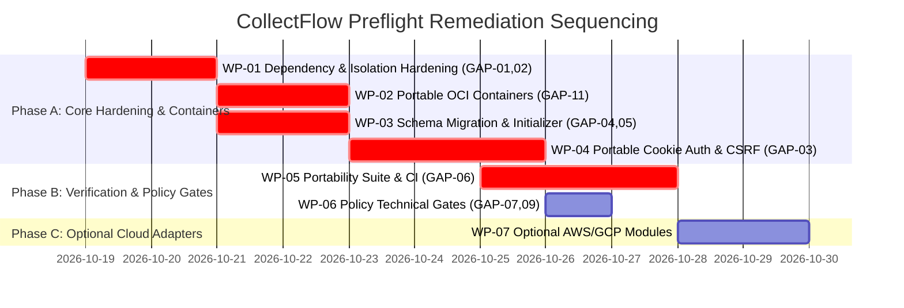

# CollectFlow Post-Phase 4C Release Readiness Gap Assessment

**Document Reference:** `COLLECTFLOW_RELEASE_READINESS_GAP_ASSESSMENT.md`  
**Stage:** Post-Phase 4C Release Readiness Preflight (Revised per Product Owner Cloud-Agnostic Direction)  
**Date:** October 18, 2026  
**Status:** COMPLETE — AUTHORIZED FOR ARCHITECTURE REVIEW  
**Assessment Result:** `NEEDS SECURITY / ARCHITECTURE DECISIONS`  

---

## 1. Executive Summary & Strategic Context

This gap assessment provides an evidence-based technical evaluation of the complete PostgreSQL-backed CollectFlow application following the acceptance of Phase 4C (Stage 4C.6).

Per Product Owner directive, **CollectFlow must be 100% cloud-agnostic and deployable on-premises, in private clouds, or across any major public cloud (AWS, Azure, GCP)** without modifying application source code or business logic:
- The previous Cloudflare Workers environment was a development/UAT staging adapter, **not** the permanent or mandatory production architecture.
- Core packaging must be based on portable OCI container images, standard PostgreSQL 16+, and generic HTTP/S reverse proxy ingress (Nginx, Traefik, Kubernetes Ingress).
- Application code must remain free of proprietary cloud SDKs (AWS Boto3, Cloudflare SDKs).

While the application demonstrates mathematical precision ($\Delta = ₹0.00$), robust transactional row-locking (`with_for_update`), and high test coverage across 39 Playwright scenarios, 115 Pytest cases, and 596 Vitest tests, transitioning into a portable enterprise production deployment reveals **11 specific technical and operational gaps**.

---

## 2. Prioritized Gap Matrix

| Gap ID | Domain | Title | Severity | Impact Category | Go-Live Blocking Status | Work Package |
|---|---|---|---|---|---|---|
| **GAP-01** | Dependencies | Incomplete Backend `requirements.txt` | **High** | Build Failure | **BLOCKER (Pre-Staging)** | WP-01 |
| **GAP-02** | Database Engine | Loopback Isolation Blocks Portable / Production PG Hosts | **Critical** | Runtime Abort | **BLOCKER (Pre-Staging)** | WP-01 |
| **GAP-03** | Auth & Session | In-Memory Token Erased on Reload (Requires Portable Cookie Auth) | **High** | User Experience / Auth | **BLOCKER (Pre-Production)** | WP-04 |
| **GAP-04** | Data Hygiene | Synthetic Fixture Script Lacks Non-Reset Safety Guard | **High** | Data Contamination | **BLOCKER (Pre-Staging)** | WP-03 |
| **GAP-05** | Provisioning | Missing Production Initializer & `must_change_password` Field | **High** | Deployment Safety / Schema | **BLOCKER (Pre-Staging)** | WP-03 |
| **GAP-06** | CI/CD | Absence of Automated GitHub Actions Workflows | **High** | Automation Mandate | **BLOCKER (Pre-Staging)** | WP-05 |
| **GAP-07** | Business Logic | Soft Deactivation Workflow & Exposure Visibility | **Medium** | Referential Integrity | **GO-LIVE DECISION** | WP-06 |
| **GAP-08** | Financial Rules | Missing Accounting Period-Locking for Closed FYs | **Medium** | Statutory Compliance | **GO-LIVE DECISION** | Pending Sign-Off |
| **GAP-09** | Financial Rules | Multi-Currency Lacks Realized Forex Accounting (INR Scope Gate) | **Medium** | Currency Accounting | **GO-LIVE DECISION** | WP-06 |
| **GAP-10** | Architecture | Dead Legacy Static Asset Coupling in FastAPI | **Low** | Architectural Hygiene | **POST-LAUNCH HARDENING** | — |
| **GAP-11** | Packaging | Frontend Nitro Locked to Cloudflare Target (Requires Node SSR) | **High** | Portability / Deployment | **BLOCKER (Pre-Staging)** | WP-02 |

---

## 3. Detailed Gap Assessments

### GAP-01: Incomplete Backend `requirements.txt` Manifest
- **Description:** The root `requirements.txt` file in the backend repository was created during legacy SQLite prototyping and was never updated during Stage 4C.1 when SQLAlchemy 2.0, PostgreSQL drivers, Alembic, and Argon2id were introduced.
- **Source Evidence:**
  - File: [`collectflow/requirements.txt`](file:///home/anishb/projects/personal/collectflow/requirements.txt#L1-L7)
  - Installed in active `venv` but missing from manifest:
    - `SQLAlchemy==2.1.4`
    - `psycopg==3.3.6`
    - `psycopg-binary==3.3.6`
    - `alembic==1.20.0`
    - `argon2-cffi==25.1.0`
- **Severity:** **High**
- **Release Impact:** Any fresh container build (Docker) or CI runner executing `pip install -r requirements.txt` will immediately crash on startup with `ModuleNotFoundError: No module named 'sqlalchemy'`.
- **Recommended Action:** Update `requirements.txt` with pinned production-ready versions of all required runtime packages.
- **Estimated Relative Effort:** Small (S, 0.5–1 day)
- **Work Package:** **WP-01**
- **Go-Live Blocking Status:** **BLOCKER (Pre-Staging)**

---

### GAP-02: Hardcoded Loopback Isolation Blocks Portable / Production PG Hosts
- **Description:** To ensure strict non-production safety during Stage 4C testing, `app/core/database.py` enforces a rigid whitelist of environment names, database names, and host IP addresses. It explicitly rejects `production` as an environment mode and raises a fatal exception if connecting to any non-loopback host (e.g., container host `postgres`, on-premises server, or cloud RDS/Cloud SQL).
- **Source Evidence:**
  - File: [`collectflow/app/core/database.py`](file:///home/anishb/projects/personal/collectflow/app/core/database.py#L22-L52)
  - Lines 124–128:
    ```python
    if host not in PERMITTED_LOOPBACK_HOSTS:
        raise RuntimeError(f"CRITICAL ISOLATION ERROR: Remote host '{url.host}' is prohibited...")
    ```
- **Severity:** **Critical**
- **Release Impact:** The backend application is physically incapable of running in Docker Compose (`postgres:5432`), Kubernetes, on-premises VMs, or cloud environments. Setting `COLLECTFLOW_ENV=production` or providing a non-loopback DSN immediately crashes the application.
- **Recommended Action:** Refactor `app/core/database.py` to support a formal `production` mode:
  - Allow standard PostgreSQL connection URLs (`COLLECTFLOW_DATABASE_URL`) pointing to any resolvable hostname or IP.
  - Require credentials via secure environment variables.
  - Require SSL mode (`sslmode=require`) when connecting over public networks; allow unencrypted loopback/internal bridge connections for trusted Docker networks.
  - Retain loopback and name restrictions strictly for `COLLECTFLOW_ENV=test` and `dev`.
- **Estimated Relative Effort:** Medium (M, 2 days)
- **Work Package:** **WP-01**
- **Go-Live Blocking Status:** **BLOCKER (Pre-Staging)**

---

### GAP-03: In-Memory Session Token Erased on Browser Reload (Requires Portable Cookie Auth)
- **Description:** In Stage 4B/4C, session tokens were moved out of `localStorage` into in-memory React state (`ApiClient.inMemoryToken`) to eliminate persistent XSS vulnerability. However, because in-memory state does not survive browser page reloads or tab closures, end-users are forced back to `/login` upon pressing F5, clicking browser reload, or reopening a tab.
- **Source Evidence:**
  - File: [`cash-flow-buddy-101/src/lib/api-client.ts`](file:///home/anishb/projects/personal/cash-flow-buddy-101/src/lib/api-client.ts#L8-L12,L69-L71)
- **Severity:** **High**
- **Release Impact:** Critical user experience friction in production across all deployment targets. Financial users navigating between tabs or refreshing reports constantly lose their session state and unsubmitted drawer inputs.
- **Recommended Action:** Transition to the provider-neutral **Same-Origin Reverse Proxy + `HttpOnly` Cookie** session architecture:
  - Ingress/reverse proxy (Nginx, Traefik, Ingress Controller, or Cloudflare) unifies `/*` and `/api/*` under a single origin.
  - Backend issues `Set-Cookie: collectflow_session=<token>; Path=/api; HttpOnly; Secure; SameSite=Lax`.
  - Frontend `ApiClient` sends standard fetch requests with credentials included.
  - Enforce CSRF defense via custom header: `X-Requested-With: XMLHttpRequest`.
- **Estimated Relative Effort:** Medium (M, 3 days)
- **Work Package:** **WP-04**
- **Go-Live Blocking Status:** **BLOCKER (Pre-Production)**

---

### GAP-04: Synthetic Baseline Seeding Script Lacks Non-Reset Safety Guard
- **Description:** In Stage 4C.6, a strict safety guard was added to the *reset* branch of `seed_postgres_fixtures.py` (requiring `COLLECTFLOW_ENV=test` and `db_name=collectflow_test`). However, if the script is invoked without the `--reset` flag, the seeder executes without verifying that the target environment is a test database.
- **Source Evidence:**
  - File: [`collectflow/scripts/seed_postgres_fixtures.py`](file:///home/anishb/projects/personal/collectflow/scripts/seed_postgres_fixtures.py#L57-L80)
- **Severity:** **High**
- **Release Impact:** An accidental invocation of `python scripts/seed_postgres_fixtures.py` against any production database will inject synthetic test accounts with publicly known passwords and fictitious financial records into real books.
- **Recommended Action:** Wrap the entire `seed_fixtures()` function in an unconditional environment check:
  ```python
  if env_mode != "test" or db_name != "collectflow_test":
      raise RuntimeError("CRITICAL SAFETY ABORT: Synthetic fixtures can only be seeded into 'collectflow_test' with COLLECTFLOW_ENV='test'.")
  ```
- **Estimated Relative Effort:** Small (S, 0.5 day)
- **Work Package:** **WP-03**
- **Go-Live Blocking Status:** **BLOCKER (Pre-Staging)**

---

### GAP-05: Missing Production Initializer & `must_change_password` Database Column
- **Description:** Two coupled issues exist for clean production bootstrapping:
  1. There is no script for initializing an empty production database with clean statutory master data (FY, GST, TDS) without pulling in synthetic accounts.
  2. The `User` domain model ([`domain_models.py#L85-L96`](file:///home/anishb/projects/personal/collectflow/app/models/domain_models.py#L85-L96)) **does not possess a `must_change_password` column**. Forced password rotation cannot be enforced without database schema support.
- **Source Evidence:**
  - Absence of `scripts/init_production_db.py`.
  - `User` table definition lacks `must_change_password`.
- **Severity:** **High**
- **Release Impact:** Initial administrator credentials cannot be securely rotated under enforcement; production bootstrapping would require manual SQL scripts.
- **Recommended Action:**
  1. Author an additive Alembic migration adding `must_change_password = Column(Boolean, nullable=False, default=False)` to `users`.
  2. Develop `scripts/init_production_db.py` to seed statutory reference masters and bootstrap exactly one admin with a CSPRNG password delivered strictly via secure environment/volume file.
  3. Never print bootstrap credentials to stdout or CI logs.
- **Estimated Relative Effort:** Medium (M, 2 days)
- **Work Package:** **WP-03**
- **Go-Live Blocking Status:** **BLOCKER (Pre-Staging)**

---

### GAP-06: Absence of Automated GitHub Actions CI/CD Pipeline Definitions
- **Description:** Neither repository contains a `.github/workflows` directory. All testing (115 Pytest, 596 Vitest, 39 Playwright UAT, cross-layer reconciliation) has been performed manually on a local workstation.
- **Source Evidence:**
  - `collectflow/.github` does not exist.
  - `cash-flow-buddy-101/.github` does not exist.
- **Severity:** **High**
- **Release Impact:** Violates the authorized automation-first release mandate. Introduces risks of untested code reaching release branches and manual deployment human error.
- **Recommended Action:** Implement GitHub Actions pipelines:
  - `ci.yml`: Automated pull request validation (Ruff, ESLint, TypeScript, Pytest, Vitest).
  - `release.yml`: Ephemeral PostgreSQL 16 container, Playwright LIVE UAT, 5-source reconciliation, portable OCI image build with SLSA provenance, and Docker Compose portability verification.
- **Estimated Relative Effort:** Medium (M, 3 days)
- **Work Package:** **WP-05**
- **Go-Live Blocking Status:** **BLOCKER (Pre-Staging)**

---

### GAP-07: Customer Soft-Deactivation Workflow & Open Exposure Visibility
- **Description:** Physical customer deletion (`DELETE /api/customers/{id}`) strictly verifies that no purchase orders or invoices reference the customer. However, soft-deactivation (`PUT /api/customers/{id}` with `is_active=False`) does not validate or warn about open purchase orders or outstanding commercial receivables.
- **Source Evidence:**
  - File: [`collectflow/app/routers/customers.py`](file:///home/anishb/projects/personal/collectflow/app/routers/customers.py#L363-L365)
- **Severity:** **Medium**
- **Release Impact:** Deactivating a customer could cause unbilled order commitments or open receivables to be overlooked by operational staff if filters inadvertently exclude inactive accounts.
- **Recommended Action (Revised per Independent Architecture Review):**
  - Do **NOT** automatically cancel unbilled purchase orders upon customer deactivation. Order cancellation is a distinct commercial action requiring formal cancellation reasons.
  - Deactivating a customer blocks creating *new* orders or invoices for that customer.
  - Existing unbilled purchase orders and invoices remain legally active.
  - Ensure Reports Hub, Customer Exposure views, and AR Aging summaries continue to display inactive customers who possess open balances (flagged with an "Inactive Customer" badge).
- **Estimated Relative Effort:** Small (S, 1 day)
- **Work Package:** **WP-06**
- **Go-Live Blocking Status:** **GO-LIVE DECISION (Pre-Production)**

---

### GAP-08: Missing Accounting Period-Locking for Closed Financial Years
- **Description:** Payment corrections and compensating reversals are currently timestamped with `corr_date` (which defaults to today, or can be specified as long as $\ge \text{orig.payment\_date}$). If a payment from a prior, closed financial year (e.g. FY 2024-25) is reversed today, the reversal transaction is posted in FY 2026-27 without statutory period-closing enforcement.
- **Source Evidence:**
  - File: [`collectflow/app/routers/payments.py`](file:///home/anishb/projects/personal/collectflow/app/routers/payments.py#L538-L544,L586)
- **Severity:** **Medium**
- **Release Impact:** Reversals posted across closed financial year boundaries can alter audited operational reporting or conflict with filed GST returns (GSTR-1 / GSTR-3B) and TDS returns (Form 26Q) without formal period-locking controls.
- **Recommended Action:** Document as Business Policy Decision BPD-01. Keep statutory accounting and closed-period decisions explicitly **PENDING QUALIFIED FINANCE / AUDITOR APPROVAL**.
- **Estimated Relative Effort:** Medium (M, 3 days)
- **Work Package:** Pending Policy Approval
- **Go-Live Blocking Status:** **GO-LIVE DECISION (Pre-Production)**

---

### GAP-09: Multi-Currency Invoicing Lacks Realized Forex Accounting (INR Scope Gate)
- **Description:** The `purchase_orders` and `commercial_invoices` tables support foreign currencies (`currency`, `exchange_rate`). However, the `payment_transactions` table only tracks INR amounts (`cash_amount`, `tds_amount`, `total_settled`) without recording realized exchange gains or losses when settlement exchange rates diverge from invoice booking rates.
- **Source Evidence:**
  - Model: [`collectflow/app/models/domain_models.py`](file:///home/anishb/projects/personal/collectflow/app/models/domain_models.py#L257-L286).
- **Severity:** **Medium**
- **Release Impact:** Invoices issued in foreign currencies cannot reconcile accurately if exchange rates fluctuate between invoice issuance and remittance receipt.
- **Recommended Action:**
  - Subject to Product Owner & Finance approval (BPD-04), implement an explicit technical enforcement gate restricting v1.0 billing strictly to INR:
    ```python
    if item.currency != "INR" or item.exchange_rate != Decimal("1.000000"):
        raise HTTPException(status_code=400, detail="Only domestic INR transactions are supported in CollectFlow v1.0.")
    ```
- **Estimated Relative Effort:** Small (S, 0.5 day for technical gate)
- **Work Package:** **WP-06**
- **Go-Live Blocking Status:** **GO-LIVE DECISION (Scoped Feature Gate)**

---

### GAP-10: Legacy Embedded Static Asset Serving in FastAPI Backend
- **Description:** The backend `app/main.py` contains legacy routes mounting `/static` and rendering `templates/index.html` from an earlier phase before the frontend was completely decoupled into the TanStack/Vite application.
- **Source Evidence:**
  - File: [`collectflow/app/main.py`](file:///home/anishb/projects/personal/collectflow/app/main.py#L103-L107,L138-L142)
- **Severity:** **Low**
- **Release Impact:** Architectural clutter and minor confusion. Does not affect API functionality.
- **Recommended Action:** Remove unused static file mounts and HTML template rendering from the API service.
- **Estimated Relative Effort:** Small (S, 0.5 day)
- **Go-Live Blocking Status:** **POST-LAUNCH HARDENING**

---

### GAP-11: Frontend Nitro Output Locked to Cloudflare Target (Requires Portable Node.js SSR)
- **Description:** In [`cash-flow-buddy-101/vite.config.ts`](file:///home/anishb/projects/personal/cash-flow-buddy-101/vite.config.ts), `@lovable.dev/vite-tanstack-config` defaults the Nitro build to Cloudflare Workers output (`cloudflare-module`). There is currently no configured Dockerfile or build script targeting a standalone portable Node.js SSR container.
- **Source Evidence:**
  - File: [`cash-flow-buddy-101/vite.config.ts#L1-L15`](file:///home/anishb/projects/personal/cash-flow-buddy-101/vite.config.ts#L1-L15)
  - Output currently targets `.output/server/index.mjs` assuming Cloudflare execution context.
- **Severity:** **High**
- **Release Impact:** Prevents deploying the frontend on generic Linux servers, Docker Compose, Kubernetes, or private cloud infrastructure.
- **Recommended Action:**
  - Configure `NITRO_PRESET=node-server` build target.
  - Author a portable multi-stage Dockerfile (`node:22-slim`) that compiles the frontend and runs `node .output/server/index.mjs` listening on `PORT=3000`.
  - Maintain `cloudflare-module` as an optional alternative preset.
- **Estimated Relative Effort:** Medium (M, 2 days)
- **Work Package:** **WP-02**
- **Go-Live Blocking Status:** **BLOCKER (Pre-Staging)**

---

## 4. Remediation Work Package Roadmap (WP-01 to WP-07)


