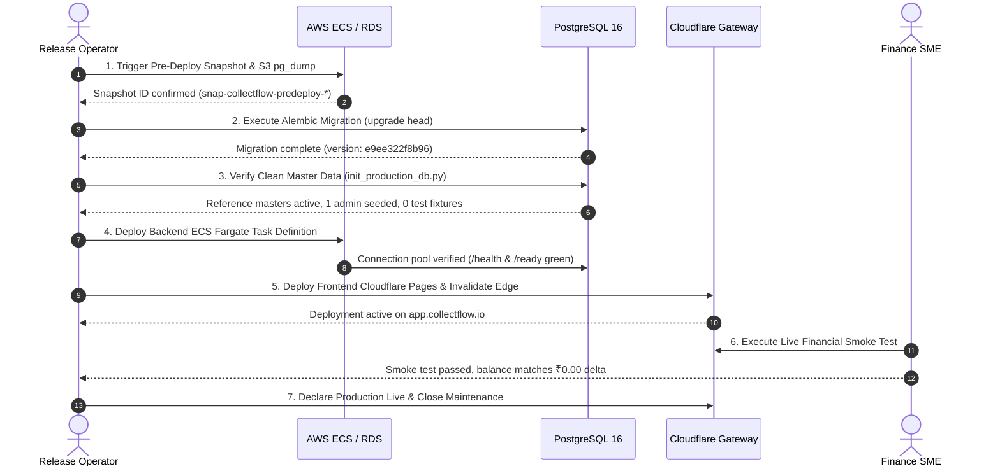
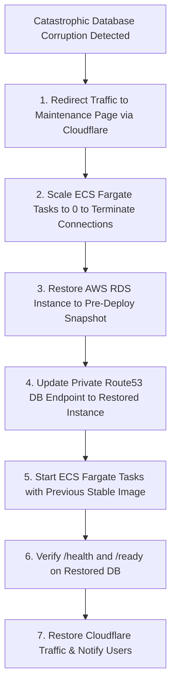

# CollectFlow Production Release and Rollback Runbook

**Document Reference:** `COLLECTFLOW_RELEASE_AND_ROLLBACK_RUNBOOK.md`  
**Stage:** Post-Phase 4C Release Readiness Preflight  
**Date:** October 18, 2026  
**Status:** PROPOSED STANDARD OPERATING PROCEDURE (SOP) — DRAFT  
**Target Environment:** Staging & Production (PostgreSQL 16, ECS Fargate, Cloudflare Pages)  

---

## 1. Scope, Objectives & Operational Principles

This runbook defines the authoritative, step-by-step operational procedure for executing a controlled production release of the complete CollectFlow application (FastAPI backend, React/TanStack frontend, and PostgreSQL 16 database), as well as standard emergency rollback workflows.

### Operational Principles
1. **Automation-First:** Every step is executed via automated CI/CD pipelines, Terraform IaC, or scripted CLI automation. Zero manual cloud portal modifications.
2. **Pre-Deployment Backup Immobility:** No migration or code rollout begins without a verified, immutable database snapshot.
3. **Zero Data Loss Invariant:** If a financial transaction discrepancy is detected post-deployment, traffic must be paused immediately to protect audit log and ledger immutability.
4. **Separation of Roles:** Release operator (DevOps) executes technical deployment; Business approver (Finance & Product Owner) issues go/no-go decisions.

---

## 2. Release Team & Communication Matrix

| Role | Responsibility | Designation / Team |
|---|---|---|
| **Incident / Release Commander** | Coordinates the maintenance window, tracks timeline, calls go/no-go | DevOps Lead |
| **Backend Deployer** | Executes database migrations, monitors ECS Fargate rollout | Senior Backend Engineer |
| **Frontend Deployer** | Monitors Cloudflare Pages build, verifies edge routing | Senior Frontend Engineer |
| **Finance Validator** | Executes live financial smoke test and verifies trial balance | Finance Controller / SME |
| **Security Monitor** | Monitors auth failure velocity, rate-limits, and WAF alerts | Application Security Lead |

**Communication Channels:**
- Bridge: `#collectflow-prod-releases` (Slack)
- Voice Bridge: Dedicated war room link
- Alert Channel: PagerDuty High-Urgency Roster

---

## 3. Pre-Flight Verification & Release Prerequisites (T - 24 Hours)

The following checklist must be 100% complete before opening the release window:

- [ ] **Accepted Git Checkpoints Verified:**
  - Backend: `collectflow` commit tagged `v1.0.0-rc`
  - Frontend: `cash-flow-buddy-101` commit tagged `v1.0.0-rc`
- [ ] **Full Automated Test Battery Passed:**
  - Backend Pytest: 115 tests passed, 0 failed
  - Frontend Vitest: 596 tests passed, 0 failed
  - Playwright LIVE UAT: 39 scenarios passed, 0 failed
  - 5-Source Reconciliation Verifier: Zero monetary delta ($\Delta = ₹0.00$)
- [ ] **Dependency & Build Manifests Locked:**
  - `requirements.txt` contains pinned versions of SQLAlchemy 2.0, psycopg3, Alembic, and Argon2-cffi.
  - Container vulnerability scan (Trivy / pip-audit) reports zero CRITICAL or HIGH vulnerabilities.
- [ ] **Secrets Provisioned in Secrets Manager:**
  - Database connection strings (`COLLECTFLOW_DATABASE_URL`) with SSL mode enforced.
  - Zero hardcoded passwords or session tokens in repository code.
- [ ] **Decision Register Sign-Offs Completed:**
  - BPD-01 (Period-Locking Policy): Signed
  - BPD-02 (Export Permissions): Signed
  - BPD-03 (Customer Deactivation): Signed
  - BPD-04 (Forex Scope - INR only for v1.0): Signed
- [ ] **Maintenance Window Scheduled & Announced:**
  - Window: Sunday 02:00 UTC – 04:00 UTC (Low commercial traffic).

---

## 4. Production Release Procedure (Step-by-Step)



### Stage 1: Pre-Deployment Backup & Snapshot (T - 15 Minutes)
1. **Trigger AWS RDS Storage Snapshot:**
   ```bash
   aws rds create-db-snapshot \
       --db-instance-identifier collectflow-prod-db \
       --db-snapshot-identifier collectflow-prod-predeploy-$(date +%Y%m%d%H%M) \
       --region ap-south-1
   ```
2. **Execute Logical pg_dump Archive:**
   ```bash
   pg_dump "postgresql://${DB_USER}:${DB_PASS}@${DB_HOST}:5432/collectflow_prod?sslmode=require" \
       --format=custom --file=/backups/collectflow_prod_predeploy.dump
   aws s3 cp /backups/collectflow_prod_predeploy.dump s3://collectflow-secure-backups/prod/
   ```

### Stage 2: Database Schema Migration (T + 0 Minutes)
1. **Execute Alembic Upgrade Head via Bastion or Runner:**
   ```bash
   export COLLECTFLOW_ENV=production
   export COLLECTFLOW_DATABASE_URL="postgresql+psycopg://${DB_USER}:${DB_PASS}@${DB_HOST}:5432/collectflow_prod?sslmode=require"
   alembic -c alembic.ini upgrade head
   ```
2. **Verify Migration Status:**
   ```bash
   alembic current
   # Expected output: e9ee322f8b96 (head)
   ```

### Stage 3: Statutory Master Data Verification (T + 10 Minutes)
1. **Execute Production Database Initializer:**
   ```bash
   python scripts/init_production_db.py --verify-empty
   ```
2. **Confirm Absence of Synthetic Test Records:**
   ```sql
   SELECT count(*) FROM users WHERE username LIKE 'sandbox_%'; -- Must return 0
   SELECT count(*) FROM customers WHERE billing_name LIKE '%Acme%'; -- Must return 0
   SELECT count(*) FROM commercial_invoices; -- Must return 0
   ```

### Stage 4: Backend Container Rollout (T + 20 Minutes)
1. **Update ECS Fargate Service with New Image Tag:**
   ```bash
   aws ecs update-service \
       --cluster collectflow-production \
       --service collectflow-backend-api \
       --task-definition collectflow-backend:${RELEASE_TAG} \
       --force-new-deployment
   ```
2. **Monitor Health Check Probes:**
   - Wait for ALB target group healthy status (2/2 targets passing).
   - Test endpoints:
     ```bash
     curl -fsSL https://api-origin.collectflow.io/health
     curl -fsSL https://api-origin.collectflow.io/ready
     ```

### Stage 5: Frontend Edge Deployment (T + 30 Minutes)
1. **Deploy Production Assets to Cloudflare Pages:**
   ```bash
   npx wrangler pages deploy dist --project-name collectflow-frontend --branch main
   ```
2. **Purge Cloudflare Edge Cache:**
   ```bash
   curl -X POST "https://api.cloudflare.com/client/v4/zones/${CF_ZONE_ID}/purge_cache" \
       -H "Authorization: Bearer ${CF_PURGE_TOKEN}" \
       -H "Content-Type: application/json" \
       --data '{"purge_everything":true}'
   ```

### Stage 6: Post-Deployment Smoke Test (T + 40 Minutes)
Finance SME logs in with primary bootstrap admin credentials:
1. **Admin Password Rotation:** Forced password change succeeds; session updates.
2. **Customer Master Creation:** Create 1 live test customer (`Customer Verification Corp`).
3. **Purchase Order Creation:** Create PO with 18% GST; verify exclusive + tax = total math.
4. **PO-to-Invoice Conversion:** Convert to commercial invoice; verify unbilled AR transitions to recognized invoice balance.
5. **Authoritative Export Check:** Generate 17-column Excel export; verify ticket single-use consumption.
6. **Cancellation & Cleanup:** Formally cancel the test invoice with audit reason `"Post-Deployment Release Verification"`; verify balance returns to ₹0.00.

### Stage 7: Production Live Declaration (T + 60 Minutes)
Release Commander confirms all smoke tests passed and announces launch in `#collectflow-announcements`.

---

## 5. Rollback & Emergency Recovery Procedures

### 5.1 Rollback Decision Criteria
A mandatory rollback must be initiated if ANY of the following conditions occur:
1. **Readiness Probe Failure:** Backend `/ready` fails for $> 3$ consecutive minutes after container deployment.
2. **Elevated Error Rate:** HTTP 5xx responses exceed **0.5%** over any 5-minute window.
3. **Database Migration Failure:** `alembic upgrade head` throws an unrecoverable SQL syntax or deadlock error.
4. **Authentication Failure:** Valid credentials fail Argon2id verification or session cookies cannot be established.
5. **Data Ledger Corruption:** Any balance discrepancy ($\Delta > ₹0.00$) detected during smoke testing.

---

### 5.2 Rollback Procedure A: Stateless Application Reversion (Duration: < 2 Minutes)
*Use when database migrations succeeded or were backward-compatible, but the backend application or frontend UI contains a runtime defect.*

1. **Revert ECS Fargate Task Definition:**
   ```bash
   aws ecs update-service \
       --cluster collectflow-production \
       --service collectflow-backend-api \
       --task-definition collectflow-backend:${PREVIOUS_STABLE_TAG} \
       --force-new-deployment
   ```
2. **Revert Cloudflare Pages Deployment:**
   - In Cloudflare Pages dashboard (or via Wrangler CLI), roll back to the previous deployment ID:
     ```bash
     wrangler pages deployment rollback ${PREVIOUS_DEPLOYMENT_ID} --project-name collectflow-frontend
     ```
3. **Verify Restored Application:**
   ```bash
   curl -fsSL https://app.collectflow.io/health
   ```

---

### 5.3 Rollback Procedure B: Database Schema Downgrade (Duration: < 5 Minutes)
*Use when an Alembic migration failed midway or must be rolled back before customer transactions occur.*

1. **Execute Alembic Downgrade:**
   ```bash
   export COLLECTFLOW_ENV=production
   export COLLECTFLOW_DATABASE_URL="postgresql+psycopg://${DB_USER}:${DB_PASS}@${DB_HOST}:5432/collectflow_prod?sslmode=require"
   alembic -c alembic.ini downgrade -1
   ```
2. **Verify Schema Revision:**
   ```bash
   alembic current
   ```

---

### 5.4 Rollback Procedure C: Catastrophic Point-In-Time Restore (Duration: 15–30 Minutes)
*Use in the worst-case scenario where database data corruption occurred or destructive table changes cannot be downgraded.*



1. **Redirect Traffic to Maintenance Page:**
   - Activate Cloudflare Maintenance Worker: routes all requests to static HTTP 503 maintenance page.
2. **Terminate Active Backend Connections:**
   ```bash
   aws ecs update-service --cluster collectflow-production --service collectflow-backend-api --desired-count 0
   ```
3. **Restore RDS Database from Snapshot:**
   ```bash
   aws rds restore-db-instance-from-db-snapshot \
       --db-instance-identifier collectflow-prod-restored \
       --db-snapshot-identifier collectflow-prod-predeploy-${SNAPSHOT_TIMESTAMP} \
       --db-instance-class db.t4g.medium \
       --publicly-accessible false \
       --region ap-south-1
   ```
4. **Switch Internal DNS Endpoint:**
   - Update Route53 private record `db.internal.collectflow.io` to point to the newly restored RDS instance.
5. **Restart Backend Tasks:**
   ```bash
   aws ecs update-service --cluster collectflow-production --service collectflow-backend-api --desired-count 2
   ```
6. **Verify Restored Integrity & Reopen Traffic:**
   - Verify zero data loss up to the pre-deployment timestamp.
   - Deactivate Cloudflare maintenance mode.

---

## 6. Post-Release Hypercare & Verification (T + 48 Hours)

During the 48-hour hypercare window following production launch:
1. **Telemetry Watch:**
   - Continuous inspection of Datadog / CloudWatch 5xx error logs.
   - PagerDuty priority escalation for any error originating in `app/routers/payments.py`.
2. **Reconciliation Audit at T + 24 Hours:**
   - Run automated reconciliation verifier against production read-replica:
     $$\sum \text{Invoiced} - \sum \text{Settled} = \sum \text{Outstanding AR} \quad (\Delta = ₹0.00)$$
3. **Formal Release Closeout:**
   - If zero Sev-1/Sev-2 incidents occur within 48 hours, Release Commander formally closes the hypercare window and archives the release log.
