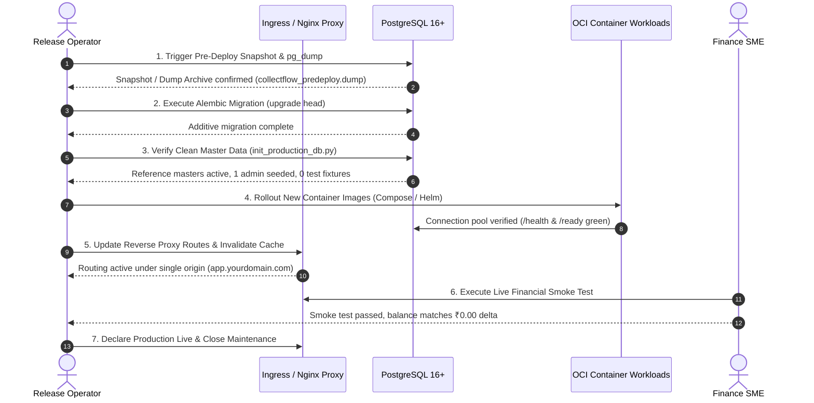
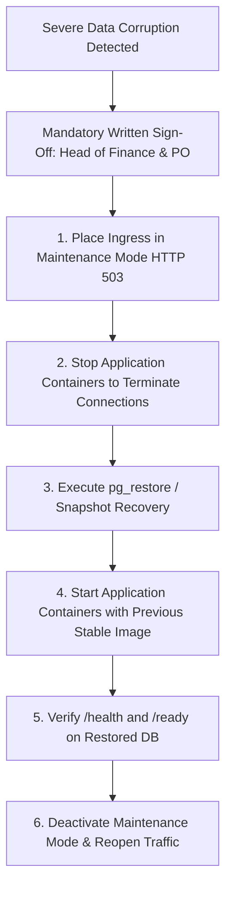

# CollectFlow Production Release and Rollback Runbook

**Document Reference:** `COLLECTFLOW_RELEASE_AND_ROLLBACK_RUNBOOK.md`  
**Stage:** Post-Phase 4C Release Readiness Preflight (Revised per Product Owner Cloud-Agnostic Direction)  
**Date:** October 18, 2026  
**Status:** PROPOSED STANDARD OPERATING PROCEDURE (SOP) — DRAFT  
**Target Environments:** On-Premises (Linux Docker Compose), Kubernetes (Helm), or Cloud (AWS/GCP/Azure)  

---

## 1. Scope, Objectives & Operational Principles

This runbook defines the authoritative, step-by-step operational procedure for executing a controlled production release of the complete CollectFlow application (FastAPI backend container, React/TanStack Node.js SSR frontend container, generic reverse proxy, and PostgreSQL 16+ database), as well as standard emergency rollback workflows.

### Operational Principles
1. **Cloud-Agnostic & On-Premises Architecture:** Every deployment procedure targets portable OCI containers, standard PostgreSQL 16+, and generic HTTP/S reverse proxy ingress. Cloud-specific services (AWS ECS/RDS, Cloudflare) are optional reference adapters.
2. **Automation-First:** Every step is executed via automated CI/CD pipelines, container orchestration (Docker Compose / Helm), or scripted CLI automation. Zero manual cloud portal modifications.
3. **Pre-Deployment Backup Immobility:** No migration or code rollout begins without a verified, immutable database snapshot or logical `pg_dump`.
4. **Zero Destructive Downward Migrations in Production:** Generic `alembic downgrade -1` commands are strictly forbidden in production; migrations must follow the additive Expand-and-Contract pattern.
5. **Zero Data Loss Invariant:** If a financial transaction discrepancy is detected post-deployment, traffic must be paused immediately to protect audit log and ledger immutability.
6. **No Claim of Automatic Lossless Restore:** Restoring a database snapshot resets state to historical point; any transactions recorded between the snapshot and disaster would be lost unless reconciled from external bank records.
7. **Separation of Roles:** Release operator (DevOps) executes technical deployment; Business approver (Finance & Product Owner) issues go/no-go decisions.

---

## 2. Release Team & Communication Matrix

| Role | Responsibility | Designation / Team |
|---|---|---|
| **Incident / Release Commander** | Coordinates the maintenance window, tracks timeline, calls go/no-go | DevOps Lead |
| **Backend Deployer** | Executes database migrations, monitors backend container rollout | Senior Backend Engineer |
| **Frontend Deployer** | Monitors frontend container rollout, verifies reverse proxy ingress | Senior Frontend Engineer |
| **Finance Validator** | Executes live financial smoke test and verifies trial balance | Finance Controller / SME |
| **Security Monitor** | Monitors auth failure velocity, rate-limits, and reverse proxy alerts | Application Security Lead |

**Communication Channels:**
- Bridge: `#collectflow-prod-releases` (Slack / Teams / Matrix)
- Alert Channel: PagerDuty / Opsgenie High-Urgency Roster

---

## 3. Pre-Flight Verification & Release Prerequisites (T - 24 Hours)

The following checklist must be 100% complete before opening the release window:

- [ ] **Accepted Git Checkpoints Verified:**
  - Backend: `collectflow` commit tagged `v1.0.0-rc`
  - Frontend: `cash-flow-buddy-101` commit tagged `v1.0.0-rc`
- [ ] **Full Automated Test Battery Passed:**
  - Backend Pytest: 115 tests passed, 0 failed
  - Frontend Vitest: 596 tests passed, 0 failed
  - Playwright LIVE UAT: 39 scenarios passed, 0 failed
  - 5-Source Reconciliation Verifier: Zero monetary delta ($\Delta = ₹0.00$)
- [ ] **Portable Container Images Built & Scanned (WP-02):**
  - `collectflow-api:v1.0.0` (Python 3.12-slim)
  - `collectflow-web:v1.0.0` (Node 22-slim with `node-server` preset)
  - Container vulnerability scan (Trivy / pip-audit / npm audit) reports zero CRITICAL or HIGH vulnerabilities.
- [ ] **Dependency & Build Manifests Locked (WP-01):**
  - `requirements.txt` contains pinned versions of SQLAlchemy 2.0, psycopg3, Alembic, and Argon2-cffi.
- [ ] **Database Schema Prerequisite Applied (WP-03):**
  - Additive migration for `must_change_password` column in `users` table prepared.
- [ ] **Secrets Provisioned via Provider-Neutral Interface:**
  - Database connection strings (`COLLECTFLOW_DATABASE_URL`) with SSL mode enforced.
  - Zero hardcoded passwords or session tokens in repository code.
  - Bootstrap administrator password delivery configured via secure environment variable, Docker secret, or Kubernetes secret. Never output to stdout or CI logs!
- [ ] **Decision Register Sign-Offs Completed:**
  - BPD-01 (Period-Locking Policy): Signed by Finance & Auditor
  - BPD-02 (Export Permissions): Signed by PO & Sales Lead
  - BPD-03 (Customer Deactivation): Signed by PO & Finance
  - BPD-04 (Domestic INR Scope Technical Gate): Signed by PO & Finance
- [ ] **Maintenance Window Scheduled & Announced:**
  - Window: Sunday 02:00 UTC – 04:00 UTC (Low commercial traffic).

---

## 4. Production Release Procedure (Step-by-Step)



### Stage 1: Pre-Deployment Backup & Snapshot (T - 15 Minutes)
1. **Execute Logical pg_dump Archive:**
   ```bash
   pg_dump -Fc -v -d "${COLLECTFLOW_DATABASE_URL}" -f "/backups/collectflow_predeploy_$(date +%Y%m%d_%H%M%S).dump"
   ```
2. **Trigger Storage Snapshot (Managed or Self-Hosted):**
   - *Docker / On-Premises:* Snapshot VM volume or LVM volume.
   - *AWS RDS:* `aws rds create-db-snapshot --db-instance-identifier collectflow-prod-db --db-snapshot-identifier collectflow-predeploy-$(date +%Y%m%d%H%M)`.
   - *GCP Cloud SQL:* `gcloud sql backups create --instance=collectflow-prod-db`.

### Stage 2: Database Schema Migration (T + 0 Minutes)
1. **Execute Additive Alembic Upgrade via Ephemeral Container or Runner:**
   ```bash
   docker run --rm \
       --network collectflow-net \
       -e COLLECTFLOW_ENV=production \
       -e COLLECTFLOW_DATABASE_URL="${COLLECTFLOW_DATABASE_URL}" \
       collectflow-api:v1.0.0 \
       alembic -c alembic.ini upgrade head
   ```
2. **Verify Migration Status:**
   ```bash
   docker run --rm \
       --network collectflow-net \
       -e COLLECTFLOW_ENV=production \
       -e COLLECTFLOW_DATABASE_URL="${COLLECTFLOW_DATABASE_URL}" \
       collectflow-api:v1.0.0 \
       alembic -c alembic.ini current
   ```

### Stage 3: Statutory Master Data Verification (T + 10 Minutes)
1. **Execute Production Database Initializer:**
   ```bash
   docker run --rm \
       --network collectflow-net \
       -e COLLECTFLOW_ENV=production \
       -e COLLECTFLOW_DATABASE_URL="${COLLECTFLOW_DATABASE_URL}" \
       -e BOOTSTRAP_ADMIN_PASSWORD_FILE=/run/secrets/bootstrap_password \
       collectflow-api:v1.0.0 \
       python scripts/init_production_db.py --verify-empty
   ```
2. **Confirm Absence of Synthetic Test Records:**
   ```sql
   SELECT count(*) FROM users WHERE username LIKE 'sandbox_%'; -- Must return 0
   SELECT count(*) FROM customers WHERE billing_name LIKE '%Acme%'; -- Must return 0
   SELECT count(*) FROM commercial_invoices; -- Must return 0
   ```

### Stage 4: Container Workload Deployment (T + 20 Minutes)

#### Deployment Option A: On-Premises / Docker Compose
```bash
# Pull new images and restart services with zero downtime
docker compose -f docker-compose.prod.yml pull
docker compose -f docker-compose.prod.yml up -d --remove-orphans
```

#### Deployment Option B: Cloud-Native Kubernetes / Helm
```bash
helm upgrade --install collectflow ./helm/collectflow \
    --namespace collectflow-prod \
    --set backend.image.tag=v1.0.0 \
    --set frontend.image.tag=v1.0.0
```

#### Health Check Verification:
```bash
# Probe backend and frontend container health
curl -fsSL http://localhost:8000/health
curl -fsSL http://localhost:8000/ready
curl -fsSL http://localhost:3000/
```

### Stage 5: Ingress & Reverse Proxy Verification (T + 30 Minutes)
1. **Verify Unified Origin Routing:**
   - Verify `https://app.yourdomain.com/` serves the frontend application.
   - Verify `https://app.yourdomain.com/api/health` returns HTTP 200.
2. **Verify TLS 1.3 Termination & Security Headers:**
   ```bash
   curl -I https://app.yourdomain.com/
   # Expect: Strict-Transport-Security, X-Content-Type-Options: nosniff, X-Frame-Options: DENY
   ```

### Stage 6: Post-Deployment Smoke Test (T + 40 Minutes)
Finance SME retrieves temporary credentials from secure secret store and logs in:
1. **Admin Password Rotation:** Forced password change succeeds; session updates.
2. **Customer Master Creation:** Create 1 live test customer (`Customer Verification Corp`).
3. **Purchase Order Creation:** Create PO with 18% GST in INR; verify exclusive + tax = total math.
4. **PO-to-Invoice Conversion:** Convert to commercial invoice; verify unbilled AR transitions to recognized invoice balance.
5. **Authoritative Export Check:** Generate 17-column Excel export; verify ticket single-use consumption.
6. **Cancellation & Cleanup:** Formally cancel the test invoice with audit reason `"Post-Deployment Release Verification"`; verify balance returns to ₹0.00.

### Stage 7: Production Live Declaration (T + 60 Minutes)
Release Commander confirms all smoke tests passed and announces launch in `#collectflow-announcements`.

---

## 5. Rollback & Emergency Recovery Procedures

### 5.1 Rollback Decision Criteria
A mandatory rollback must be initiated if ANY of the following conditions occur:
1. **Readiness Probe Failure:** Backend `/ready` fails for $> 3$ consecutive minutes after container deployment.
2. **Elevated Error Rate:** HTTP 5xx responses exceed **0.5%** over any 5-minute window.
3. **Database Migration Failure:** `alembic upgrade head` throws an unrecoverable SQL syntax or deadlock error.
4. **Authentication Failure:** Valid credentials fail Argon2id verification or session cookies cannot be established.
5. **Data Ledger Corruption:** Any balance discrepancy ($\Delta > ₹0.00$) detected during smoke testing.

---

### 5.2 Rollback Procedure A: Stateless Application Reversion (Target Convergence: 2–5 Minutes)
*Use when database migrations succeeded or were backward-compatible (additive), but the backend application or frontend UI contains a runtime defect.*

#### In Docker Compose:
```bash
# Update .env or docker-compose.prod.yml to previous stable tag
sed -i 's/v1.0.0/v0.9.0/g' docker-compose.prod.yml
docker compose -f docker-compose.prod.yml up -d
```

#### In Kubernetes:
```bash
kubectl rollout undo deployment/collectflow-backend -n collectflow-prod
kubectl rollout undo deployment/collectflow-frontend -n collectflow-prod
```

---

### 5.3 Rollback Procedure B: Database Schema Downgrades STRICTLY PROHIBITED
*Generic `alembic downgrade -1` is strictly removed and prohibited.*
- Baseline migration `e9ee322f8b96` downgrade drops all financial tables (`payment_transactions`, `commercial_invoices`, `audit_logs`).
- **Production Rule:** Never run `alembic downgrade` in production.
- If a schema issue occurs during migration, cancel the migration transaction immediately (Alembic executes DDL in transactions).
- If an additive migration was completed, the new columns remain dormant while the application is rolled back to the previous stable version (Procedure A).

---

### 5.4 Rollback Procedure C: Catastrophic Database Restore (Target Convergence: 15–40 Minutes)
*Use strictly in the catastrophic scenario where data corruption occurred and cannot be corrected via application fixes.*

> [!CAUTION]
> **GOVERNANCE MANDATE:** Restoring a database snapshot or performing Point-in-Time Recovery (PITR) terminates the current database and rolls back data. **Any financial transactions entered between the snapshot timestamp and the restore point will be lost.** 
> **Explicit written authorization from BOTH the Head of Finance and Product Owner is mandatory before initiating this procedure.**



1. **Obtain Written Emergency Authorization:** Signed by Head of Finance & Product Owner.
2. **Redirect Traffic to Maintenance Page:**
   - Configure Nginx or Ingress to serve static HTTP 503 maintenance page.
3. **Terminate Active Backend Connections:**
   ```bash
   docker compose -f docker-compose.prod.yml stop backend frontend
   # Or in K8s:
   kubectl scale deployment collectflow-backend --replicas=0 -n collectflow-prod
   ```
4. **Restore Database from Backup:**
   - *Self-Hosted / Docker:*
     ```bash
     pg_restore -v --clean --if-exists -d "${COLLECTFLOW_DATABASE_URL}" /backups/collectflow_predeploy.dump
     ```
   - *Managed RDS / Cloud SQL:* Trigger automated point-in-time restore to pre-deployment snapshot.
5. **Restart Application Containers with Previous Stable Version:**
   ```bash
   docker compose -f docker-compose.prod.yml up -d
   ```
6. **Verify Restored Integrity & Reopen Traffic:**
   - Verify trial balance matches the pre-deployment snapshot.
   - Deactivate reverse proxy maintenance mode.

---

## 6. Post-Release Hypercare & Verification (T + 48 Hours)

During the 48-hour hypercare window following production launch:
1. **Continuous Telemetry Watch:**
   - Continuous inspection of structured JSON logs for 5xx errors.
   - Immediate escalation for any error originating in `app/routers/payments.py`.
2. **Reconciliation Audit at T + 24 Hours:**
   - Run automated reconciliation verifier:
     $$\sum \text{Invoiced} - \sum \text{Settled} = \sum \text{Outstanding AR} \quad (\Delta = ₹0.00)$$
3. **Formal Release Closeout:**
   - If zero Sev-1/Sev-2 incidents occur within 48 hours, Release Commander formally closes the hypercare window and archives the release log.
